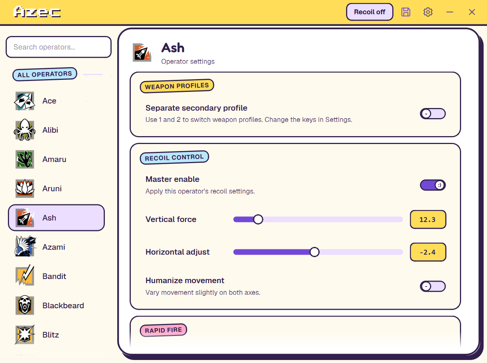
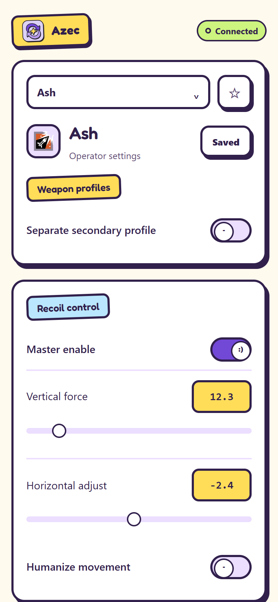
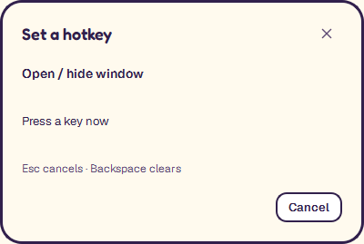
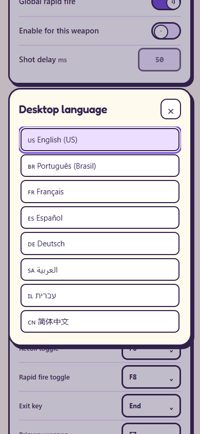

# Azec

Private Windows x64 desktop application with operator profiles, optional primary/secondary weapon settings, favorites, and paired phone controls.

## Quick start

- **Run:** download and extract the Windows package from [Releases](https://github.com/Azec-Zuckerberg/Azec/releases/latest), then open `Azec.exe`. Keep its `runtime` directory alongside it.
- **Build from source:** clone this repository, install Visual Studio 2022 C++ tools and the Windows SDK, run `setup-qt.ps1`, then run `.\build.cmd test`.
- **Phone:** open desktop Settings → Phone control and use the displayed address and pairing code in Safari on the same Wi-Fi.
- **Contributing agents:** read [AGENTS.md](AGENTS.md). [CLAUDE.md](CLAUDE.md) imports the same instructions.

The repository contains source, embedded assets, tests, scripts, and licenses. Generated application files are distributed through Releases. Personal profiles and temporary pairing credentials are excluded from Git and release packages.

## Overview

C++ / Qt 6 desktop interface for the recovered R6 behavior. The window is 864 × 650 at 100% display scale, with screen-fit sizing at higher scales, rounded outer corners, a custom title bar, a 200 px operator sidebar, and Settings inside the main window.

The interface follows GoofyUI (github.com/Azec-Zuckerberg/goofy-ui-library): a cream `#FFFAEE` canvas under a yellow `#FFDD59` header band, white surfaces with chunky ink (`#31204C`) outlines, flat colour, and hard offset ink shadows instead of blur. Live state uses the user-selectable accent, which ships as GoofyUI purple (`#7248D7`). Both pages live inside one stationary rounded white panel with a 3 px ink outline. Settings navigation crossfades over 180 ms. Controls use bundled Geist (13 px base, 14 px rows) with Fredoka display headings; operator rows are 52 px tall with 14 px Geist names and 44 px icons, and selection is a lavender pill with an ink outline. Group and section headings are GoofyUI stickers: slightly tilted colour chips with ink outlines. The Azec wordmark is rendered in the bundled Press Start 2P pixel font — chunky white pixel lettering with a hard ink shadow inside the yellow header. All header controls use centered 20 px vector icons inside matching 34 px hit targets and stay flat until pressed, focused, or selected. Clicking switches does not add an outer focus ring; keyboard navigation keeps a 2 px accent outline. Switches are GoofyUI face toggles — lavender when off, accent when on, with a white knob showing `-` or `:)`. Sliders use lavender pill tracks with white ink-rimmed handles, and numeric fields are yellow mono chips. Window corners have a 24 px radius, panel corners 24 px, and buttons and inputs use 10-18 px corners. Reactive radius remains available in Appearance. Operator changes apply a gentle 120 ms fade only to the new icon and name; the selected profile and controls update immediately, including during rapid switching.

## Screenshots



The desktop window: a yellow header band with the pixel-font Azec wordmark, the 200 px operator sidebar, and operator settings with GoofyUI sticker headings and fully round slider handles.



The paired phone page reuses the same GoofyUI materials: cream canvas, white cards with chunky ink outlines and hard offset shadows, sticker section chips, yellow number chips, and face toggles.



The hotkey dialog keeps the action and key instructions readable, with explicit cancellation.



The phone language picker stays inside the page and follows the same GoofyUI materials.

## Run

Double-click **Azec.exe**, or **Run.cmd**.

Keep the **runtime** directory alongside the launcher. It contains the actual application and the Qt libraries it needs; Qt does not need to be installed to run this packaged copy on this computer. The standard Visual C++ runtime is required on another computer.

- **Insert:** show or hide the window.
- **F6:** toggle recoil activity; starts OFF.
- **F8:** toggle global rapid fire; individual operator rapid fire starts OFF.
- **End:** immediate panic exit, including while a dialog is open; unsaved edits are discarded.
- **1 / 2:** select primary / secondary weapon when separate profiles are enabled for that operator. Both keys can be changed in Settings.
- Arrow keys make 0.1-step recoil adjustments while this window is active and a text/number field is not being edited.

Click an operator's icon/name to edit its profile. Right-click an operator for a compact Favorite / Remove favorite context-menu action with an outlined star. There is no nested push button; the action's quiet hover stays inset from the menu edge. Favorited operators move out of All operators into Favorites and return when unfavorited; each operator appears once. Both groups share one scrolling sidebar and follow the search field. The entire Favorites group is hidden when empty or when none match the search, with no placeholder or reserved space. Favorites save automatically to `azec_ui.json` beside the launcher and reload on startup.

Enable **Separate secondary profile** on an operator to add independent secondary recoil, humanization, rapid-fire, and delay settings. The first secondary profile starts as a copy of that operator's primary settings. Use the Primary / Secondary buttons or the configurable 1 / 2 keys to switch. Disabling secondary mode restores the primary profile and keeps the secondary edits for later. Selecting another operator starts on primary. Weapon shortcuts ignore number/text editing and Ctrl/Alt/Windows-key combinations.

The weapon tabs expand/collapse with a 220 ms height and opacity transition, and their selection highlights fade over 160 ms. Profile changes apply immediately. Repeated toggles reverse from the displayed position and settle on the last choice.

The Save button stores primary settings in the original compatible `r6_config.bin` and secondary profiles, weapon keys, the phone-access preference, and newer-operator profiles and selection in `azec_weapons.json`. Primary saves write and flush a temporary file before replacing the destination. Rejected primary configurations are preserved as `r6_config.corrupt-<timestamp>.bin` with a visible notice. Read/preservation failures block saving to protect the existing file.

Only one instance may use a configuration directory. Launching another copy brings the existing window forward. Separate fixture directories remain independent. A tray icon offers Open/hide, Recoil active, Global rapid fire, and Exit. Ordinary closing asks Save / Discard / Cancel when changes are unsaved; failed saves keep the app open. Every nonempty hotkey must be unique across all six actions.

Settings → Profile backup exports all primary profiles, secondary profiles, favorites, and persisted preferences into one versioned JSON file. Import validates the complete backup before applying it. Imported profile settings stay unsaved until Save is clicked; favorites retain their normal automatic persistence.

## Phone control

The advertised pairing address prefers an active physical Wi-Fi or Ethernet adapter with a gateway. Internal virtual switches without a gateway are excluded, so Hyper-V/WSL adapters cannot displace the PC's reachable LAN address. Both Copy link and the QR use this selection.

Desktop Settings uses a GoofyUI language popup and a framed hotkey dialog with wrapped instructions and Cancel. The phone uses matching language, operator, and hotkey pickers, with search for keys/operators, keyboard navigation, and Escape to dismiss. Duplicate hotkeys keep the previous binding and show the validation error without marking a working connection offline. Fresh settings and the unpaired phone page default to English; the paired page follows the saved desktop language. Existing preferences and language IDs remain compatible (Portuguese 0, English 1).

The app starts a local HTTP server automatically. In desktop **Settings → Phone control**, find its Wi-Fi address and six-digit pairing code. On an iPhone connected to the same Wi-Fi, open that address in Safari and enter the code. **Copy link** includes a session token to skip code entry. The address normally uses port 18764; the app selects another available port if needed, and Settings shows the actual address. `localhost` on the phone refers to the phone itself, so use the PC address shown in Settings.

The QR card starts blurred. Click it, or focus it and press Space, to reveal the same session link used by Copy link. Click again to conceal it. Leaving Settings, hiding the window, or changing the network address conceals it automatically. QR generation is entirely local, using bundled Project Nayuki code. The host allow-list refreshes for each request; Settings and QR address changes are detected every 2.5 seconds.

The QR uses rounded ink modules, purple finder centers, and the Azec Steady Spark logo in its center. The highest QR error-correction level protects the small logo window, and the four-module white scan margin stays clear. Module edges align to physical display pixels. Click reveal/conceal animates the colour-preserving blur over 420 ms and can reverse mid-animation. Blur textures are prepared off the GUI thread, with a gradual detail reveal and no image filtering during painting. Automatic concealment is immediate. Phone-access toggles expand/collapse only the connection details over 300 ms without rebuilding Settings or resetting its scroll position; disabling access stops the server immediately. The transition uses a transparent cached surface, keeps the toggle row stationary, and preserves the displayed height when reversed.

The Steady Spark logo also appears beside the desktop wordmark, in the window and tray icons, in the Windows launcher/runtime file icons, and on the phone page and home-screen shortcut. Its editable vector sources are `assets/logo.svg` and `assets/app-icon.svg`.

After `build.cmd test`, run `python tests/run_checks.py --ui-only --qr-scan` to check the desktop at 100% and 150% and decode the actual rendered QR images. This optional decoding check requires `opencv-python-headless`. It covers the current fixture session plus five demo URLs; session URLs are compared by hash and never printed.

The phone page edits the same in-memory profiles and global settings as the desktop, including favorites and both weapon slots. Changes apply immediately; use **Save changes** to persist them. It refreshes desktop changes while you are not editing an input. It embeds its display font and has no external fonts, libraries, or internet dependency. Keep the PC app running. If Windows requests network permission, allow the app on the private network used by the phone.

Phone access can be disabled in Settings. Pairing codes and tokens change when the app restarts. API calls require the session token, pairing attempts are rate-limited, and foreign origins/hosts are rejected. The app does not configure router forwarding or expose a public service. This HTTP control page is intended for a trusted local network.

Pairing throttling uses a bounded, expiring per-IP table and a monotonic 60-second window. It does not block correctly authenticated requests. Pairing codes and bearer tokens use a fixed-work comparison for equal-length values. The phone page follows the selected desktop language (English, Portuguese, French, Spanish, German, Arabic, Hebrew, Chinese, Japanese) and retains its token only in browser session storage.

The page includes a manifest, standalone-mode hints, and locally generated home-screen icons. Use your browser's Add to Home Screen action where available. Full PWA installation/promotion depends on the browser and its HTTPS requirements; a LAN HTTP address cannot guarantee it. The PC app and local network are still required, even when opening a home-screen shortcut.

The sidebar, operator controls, and Settings use fading scrollbars. They start invisible, fade in when scrolling, and fade out after three seconds without scrolling. Dragging keeps them visible until three seconds after release. Their narrow lanes remain reserved so fades never move the content.

The Save icon beside the gear stays neutral ink when saved and uses the current accent when settings are unsaved. It stays flat with the same artwork and transparent background, without a glow or pulse. Failed saves retain the unsaved accent and expose the error in the tooltip; successful saves restore neutral ink. The main window has no footer strip. The header gear opens an inline Settings page for hotkeys, language, sound, appearance, and the quick guide. The back arrow, gear, or an operator selection returns to the operator page. The open / hide window binding changes the opening shortcut. The header shows only Recoil off / on; its toggle hotkey remains configurable in Settings. Changing operators preserves unsaved profile edits in memory. Hotkey assignments save immediately, matching the recovered behavior.

Settings use `r6_config.bin` in the launcher directory. Existing valid files remain compatible. All previously shipped default accents (neon green, teal, coral, and the neutral chrome gray) are migrated in memory to GoofyUI purple; deliberately chosen custom colors are retained. Reset appearance restores purple and the original reactive radius. Optional `titio.png` can be placed in the same directory.

Every operator (72 in total, Ace through Noor) has a real embedded SVG icon, without generated tiles or initials placeholders, and supports an optional secondary weapon profile. Most icons come from the supplied operator folder; Ace uses its real icon from [r6operators](https://github.com/marcopixel/r6operators/tree/master/operators/ace) and Noor (the Year 11 Season 3 defender) the one from the maintained [zerobertoo/r6operators](https://github.com/zerobertoo/r6operators/tree/master/operators/noor) fork. The Downloads folder is not needed at runtime. Noor's profile and selection persist in `azec_weapons.json`, so `r6_config.bin` keeps its exact 3,734-byte layout.

Desktop text uses embedded Geist fonts with Fredoka display headings, the bundled Press Start 2P pixel font for the Azec wordmark, and Windows Consolas for connection details. Fonts work without installation or internet access. Font and additional icon licenses are retained in `licenses/Geist`, `licenses/Fredoka`, `licenses/PressStart2P`, and `licenses/r6operators`.

Desktop application strings live in `src/strings.hpp` (lookup and enum), one table per language in `src/lang_*.hpp` (English, Portuguese, French, Spanish, German, Arabic, the Arabic "Free Palestine" prank behind the Hebrew picker entry, Simplified Chinese, Japanese), and painted flag icons in `src/flags.hpp`; picking Hebrew shows the Israel flag, then reveals a Free Palestine popup with the Palestine flag and switches every label to Arabic prank text. Portuguese labels for bundled Qt color/file dialogs stay in `strings.hpp`. The phone dictionary in `assets/phone.html` covers the same languages, with RTL layout for Arabic. Favorites now include schema version 1 while still accepting existing unversioned files. Save/server/profile-load diagnostics go to `azec.log`, capped at 256 KiB with one rotated backup. Request bodies and pairing secrets are never logged. Background dots repaint only after cursor or appearance changes; operator pixmaps share a bounded Qt cache.

## Mouse output

Movement uses **Windows SendInput**, with `MOUSEEVENTF_MOVE` and relative integer X/Y deltas. Rapid fire uses the same API with left-button up/down events. The original binary's recovered workers also use SendInput.

The recovered fractional accumulation, shared X/Y humanization jitter, 12/30 ms recoil intervals, and rapid-fire sequence (up → 5 ms → down → 25 ms → up → configured delay with a 30 ms floor) remain in the C++ engine. The unused Logitech DLL lookup was removed. Idle recoil checks wait 8 ms while disabled and 4 ms while awaiting a press; idle rapid-fire press checks wait 4 ms. This may add a few milliseconds to first-press detection; active movement/fire timings are unchanged. Real input latency has not been measured in-game.

## Build

Requires Visual Studio 2022 C++ tools, a Windows SDK, and Qt 6.8.3 MSVC x64. The Qt SDK is already installed for this machine under `%LOCALAPPDATA%\NeonManagerR6\Qt`.

On another development machine, run `setup-qt.ps1` with Python available. It downloads a pinned Qt kit using aqtinstall into the user's local application-data directory. Alternatively, set `NEON_QT_ROOT` to a compatible Qt kit.

```powershell
.\build.cmd
.\build.cmd test
```

The second command runs core checks, builds a separate UI verification executable, and automatically runs isolated HTTP, restart, and single-instance checks, including the real 60-second pairing-limit expiry. Build intermediates go in `.build`. The build deploys the Qt runtime and compiles the small root launcher. Full application source is in `src`; operator SVGs and the embedded-resource manifest are in `assets`.

- `src/app.cpp` / `src/startup.hpp`: startup, single-instance activation, configuration recovery, and verification dispatch.
- `src/main_window.hpp`: window, settings, hotkeys, tray, and dialogs.
- `src/app_style.hpp` / `src/strings.hpp`: desktop styling and localized presentation text.
- `src/phone_bridge.cpp`: validated phone-to-desktop updates and state building.
- `src/profile_transfer.hpp` / `src/profile_transfer.cpp`: portable backup validation and import/export.
- `src/pairing_qr.hpp`: obscured/revealed pairing QR control.
- `src/ui_widgets.hpp`: switches, SVG rendering, sidebar rows, and section cards.
- `src/engine.cpp` / `engine.hpp`: input workers, active weapon selection, and synchronized configuration access.
- `src/profile_store.hpp`: compatible secondary-profile persistence.
- `src/phone_server.hpp` and `assets/phone.html`: paired local HTTP control server and mobile interface.
- `src/lan_address.hpp`: Windows adapter discovery and LAN pairing-address selection.
- `src/core.cpp` / `core.hpp`: original binary record layout and movement arithmetic.
- `src/launcher.cpp`: starts the packaged app with the correct working directory.
- `tests/core_checks.cpp`, `tests/ui_checks.cpp`, and `tests/run_checks.py`: verification code and isolated runners.

Project Nayuki QR-Code-generator v1.8.0 is vendored under `third_party/qrcodegen`; its MIT notice is retained in `licenses/qrcodegen`. Runnable releases include the root launcher, `runtime/`, and licenses, excluding the developer-only `runtime/Azec-checks.exe` and local settings/logs/credentials.

Qt is dynamically linked. Its license texts are in `licenses/Qt`; upstream source for the pinned release is available from [Qt Base](https://code.qt.io/cgit/qt/qtbase.git/tree/?h=v6.8.3) and [Qt SVG](https://code.qt.io/cgit/qt/qtsvg.git/tree/?h=v6.8.3). Deployment uses [windeployqt](https://doc.qt.io/qt-6/windows-deployment.html).

## Verification

Optional phone browser checks: install the Python `playwright` package and Google Chrome, then run `python tests/phone_browser_test.py`. This starts and stops an isolated dry-run instance and checks pairing, QR links, all nine languages at four widths, custom pickers, hotkey conflicts/persistence, and expired sessions. Screenshots and the JSON report stay under `.build/verification`.

The current verification passed 21 core checks, 130 UI checks at both 100% and 150% display scaling, 45 HTTP checks, 11 recovery checks, 17 phone browser checks, and restart/single-instance checks. Separate motion captures verify continuous phone reversals, fixed toggle-row height, and transparent transition backgrounds at both scales; timing-only runs omit capture overhead. Core coverage includes malformed/truncated/random input, isolation of newer-operator data from the fixed binary layout, and preservation of the previous file after a failed atomic replacement. UI coverage includes the existing layout/interaction contracts plus QR conceal/reveal and animation reversal, smooth weapon tabs, in-place phone toggles with anchored or bottom-clamped scrolling, custom-accent Save states and save failures, close cancellation, backup validation, hotkey collisions, and stationary-cursor repaint suppression.

Phone checks cover pairing, authorization, invalid values/types/slots/hosts/origins, body limits, profile isolation, global round-trips, icons/manifest, persistence, lockout isolation, and rate-limit recovery. Chrome exercised all nine languages at widths of 320, 390, 430, and 768 CSS pixels without horizontal overflow. Browser checks also covered code pairing and token links, English defaults, custom pickers, hotkey persistence/conflicts, Escape/focus behavior, and expired sessions. HTTP checks verified profile isolation and persistence after restarting. Revealed QR screenshots decoded successfully in software at both scales, while concealed screenshots did not decode. A physical phone scan, actual network-address change, and real mouse output/in-game behavior were not tested.

The Windows workflow in `.github/workflows/windows.yml` builds and runs the core, HTTP, restart/recovery, and desktop checks, then uploads selected reports/screenshots, excluding pairing-info files and revealed QR screenshots. The optional Chrome browser suite runs separately. The hosted workflow has not been run from this local session.

UI verification disables all SendInput calls:

```powershell
New-Item -ItemType Directory -Force .build\verification | Out-Null
Push-Location .build\verification
& '..\..\runtime\Azec.exe' --ui-self-test
Pop-Location
```

Run `build.cmd test` first to create `runtime/Azec-checks.exe`. The normal runtime delegates `--ui-self-test` to that separate executable; verification code is absent from the release application. To automate both isolated display-scale runs, use `python tests/run_checks.py --ui-only`.

For animation inspection, run `--ui-self-test --motion-only` in a fresh fixture directory. It records local frame sequences and timing/geometry samples for phone toggles, reversals, and QR reveal/conceal. Add `--motion-timing-only` to measure GUI responsiveness without frame-capture overhead. Keep these captures local because they include temporary pairing details.

The test writes screenshots, a JSON report, and fixture settings in its working directory. Use that isolated directory so fixture writes cannot replace personal settings. `--dry-run --exit-after-ms=6000` opens the interface without mouse output or beeps.

This remains a reconstruction, not the original developer's exact source tree. Real mouse output, Logitech hardware, and in-game behavior have not been tested; source-level or global behavioral equivalence is not claimed.
