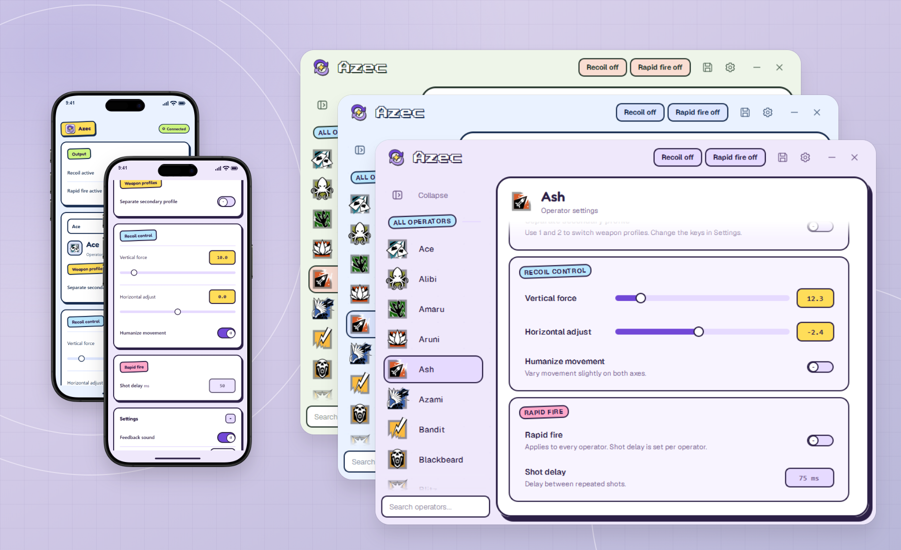
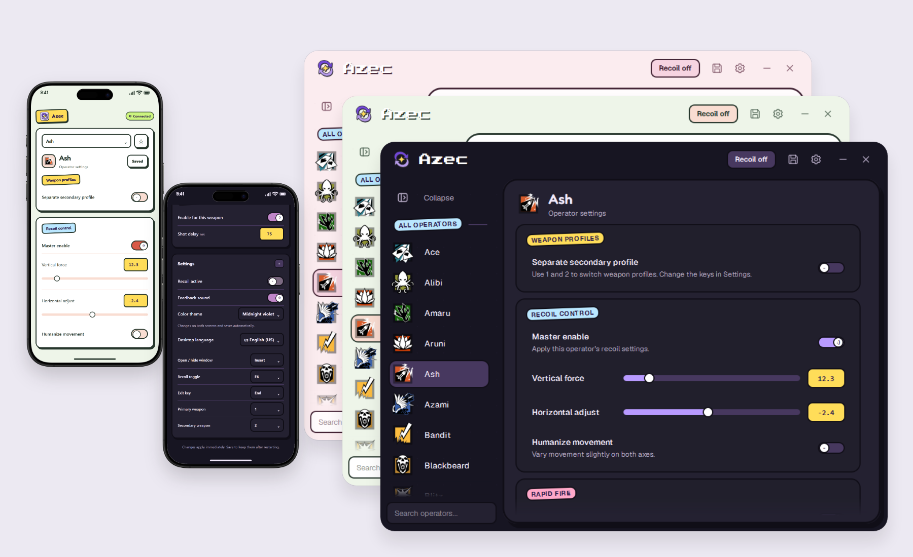

# Azec

A Windows desktop app with 78 operator profiles, independent primary and secondary weapon settings, and phone controls over your local network.





## Get started

1. Download **Azec.exe** from the [public releases](https://github.com/Azec-Zuckerberg/Azec-releases/releases/latest).
2. Open **Azec.exe**. It installs for your Windows user, opens the app, and adds **Azec** to the Start menu. Qt and the Visual C++ runtime are bundled; no source code, command prompt, or administrator rights are needed. No runtime folder appears beside the download.
3. Select an operator, adjust its settings, and click **Save**. Recoil and rapid fire start off.

The first-start tour points to the controls with an animated yellow arrow and a compact instruction box above the taskbar. Skip it at any time, or replay it from **Settings → General → Replay tour**. **Mouse setup** in the same category saves your mouse DPI and game sensitivity, reads `GameSettings.ini`, and offers a preview before rescaling recoil profiles after a sensitivity change.

### Connect your phone

Keep the PC and phone on the same local network. Open **Settings → Phone control** on the PC, then open the displayed address in your phone browser and enter the pairing code. The code is shown as a large selectable chip; **Copy code** copies just the six digits, **Copy link** copies a link that skips code entry, and **New code** rotates the code and disconnects phones that were already paired. You can also explicitly reveal and scan the QR code. Keep Azec running on the PC.

Phone edits update the same profiles as the desktop. Tap **Save changes** to keep them after restarting. The top **Output** card has the live **Recoil active** switch and a **Rapid fire active** switch for the active weapon profile, so primary and secondary can differ. No external fonts, scripts, or cloud service are required. If Windows prompts, allow network access on your private network. Use the PC address shown in Settings, not `localhost` on your phone.

## Make it yours

- **Recoil and Rapid fire:** the header shows both pills. Recoil has an on/off switch; Rapid fire belongs to the active weapon profile, so primary and secondary can be set independently. The rapid-fire card holds the shot delay for each profile. The old “Master enable” gate is gone.
- **Only in Rainbow Six:** this is on by default. Azec ignores application shortcuts and mouse output when another application is active; Alt-tab to the game and it resumes. Turn it off in **Settings → General** only if you deliberately want the old system-wide behavior. No software change can make a game macro immune to the game’s rules or anti-cheat; this reduces accidents, not account risk.
- **Goofy color themes:** **Charcoal & blush** is the default for fresh configurations. Choose it or Pistachio, Ice blue, Lilac, Butter & ocean, Rose, Midnight violet, Forest & tangerine, Deep sea & citron, and Goofy (original) in **Settings → Appearance**. Choose the same ten themes on the phone in **Settings → Color theme**. Changes from either screen sync to both and save automatically; every theme keeps the same layout, with a spacious header matching the sidebar. [See all ten themes](docs/theme-gallery.md).
- **Collapsible sidebar:** the **Collapse** button at the top of the Goofy sidebar switches between operator names and a compact icon rail. A star shortcut appears above the operator icons when you have favorites. Search stays at the bottom; click its compact icon to expand smoothly and start searching. The sidebar remembers your choice.
- **Settings categories:** General, Appearance, Shortcuts, Phone control, and Profile backup keep related options together.
- **Independent profiles:** enabling a secondary profile copies the primary once, then keeps edits separate. Disabling it preserves those edits.
- **Favorites and search:** right-click an operator to favorite it. Favorites appear once and save automatically.
- **Portable backups:** export or import profiles, favorites, the active color theme, the collapsed-sidebar choice, and the output and safety switches in **Settings → Profile backup**. Imported profile changes remain unsaved until you click Save.
- **Phone pairing:** sessions rotate on restart. **New code** rotates the code and disconnect paired phones; **Copy code** copies just the six-digit code. Phone access can be disabled in Settings.
- **Safe saving:** failed saves show a persistent banner with the problem instead of only changing the icon. The old and new settings files are rolled back together if the second write fails.

## Default shortcuts

| Key | Action |
| --- | --- |
| Insert | Show / hide the window |
| F6 | Toggle recoil activity |
| 1 / 2 | Select primary / secondary when enabled |
| Arrow keys | Adjust recoil by 0.1 while the window is active, outside text/number fields and lists |
| End | Immediate exit; unsaved edits are discarded. Only while Rainbow Six is active and Azec is not the active window. |
| Ctrl+S | Save the configuration |
| Ctrl+F | Focus the operator search |
| Esc | Leave Settings, or clear the search field |

Weapon and action bindings are configurable in Settings. Show/hide, recoil-toggle and panic shortcuts reject ordinary typing and list-navigation keys. Ordinary closing offers **Save / Discard / Cancel** when there are unsaved edits and plays a soft two-note “no” cue; it does not use the Windows error beep.

## Build from source

Requires Windows x64, Visual Studio 2022 C++ tools, a Windows SDK, Python, and Qt **6.8.3 MSVC x64**.

```powershell
.\setup-qt.ps1
.\build.cmd
```

`setup-qt.ps1` installs the pinned Qt kit. Set `NEON_QT_ROOT` to use another compatible installation. Build intermediates live in `.build/`; the launcher is `Azec.exe`, with deployed files in `runtime/`.

Testing is proportional to the change. Documentation and other trivial edits do **not** require the full suite. For substantial behavior changes:

```powershell
.\build.cmd test
```

This runs core, HTTP, recovery, and restart checks without the 61-second expiry wait. Desktop and browser checks are opt-in; 150% scaling and the complete language matrix are extended checks. See [Testing](docs/testing.md) for commands and when to use them.

## Share one file

```powershell
.\share.cmd
```

`share.cmd` stamps an automatic version, rebuilds the app, embeds the runtime and licenses, and writes **`dist\Azec.exe`**. It smoke-tests the real EXE in an isolated installation before reporting success. Send that single file: your friend opens it once, then uses **Azec** in Start. Program files live in Windows' per-user application folder (normally `%LOCALAPPDATA%\Programs\Azec`). Character profiles, primary/secondary weapon settings, favorites, theme, and other preferences live separately in **`%LOCALAPPDATA%\Azec`**. The downloaded EXE can be deleted after installation.

```powershell
.\share.cmd quick      # repackage the current build without recompiling
.\share.cmd publish    # also upload the build to a public releases-only repository
```

When explicitly skipping all packaging tests, set `$env:AZEC_SKIP_TESTS = "1"` before running `share.cmd`; this skips its installer smoke test.

`publish` uses the GitHub CLI and uploads to `github.com/Azec-Zuckerberg/Azec-releases`: the binaries are public while this source repository stays private. The stable link is `https://github.com/Azec-Zuckerberg/Azec-releases/releases/latest/download/Azec.exe`.

**Settings → General → Updates** checks the public release and asks before installing a newer build. The download must match its SHA-256 before it can run. Updates wait for Azec to close, prepare a separate versioned runtime, and preserve the data folder. Existing portable profiles beside the EXE are copied on first installation if the installed settings store is empty; originals are preserved and existing installed profiles are never overwritten. For a first installation with existing portable profiles, place this new EXE in the portable folder and run it after closing the old app. Later transfers use Profile backup. The app remains usable offline.

`package-release.ps1` still produces the folder-style `dist/Azec-portable.zip` for anyone who prefers an unzipped portable copy. It refuses to package a runtime that is missing Qt or the C++ runtime DLLs, and excludes `Azec-checks.exe`, stale `Azec.exe` backups, personal configuration and logs, and pairing captures.

## Documentation

- [Testing and verification](docs/testing.md) — fast defaults, targeted checks, extended coverage, and safe fixtures.
- [Application reference](docs/reference.md) — detailed UI, phone pairing, persistence, and input behavior.
- [Agent instructions](AGENTS.md) — architecture, compatibility contracts, and change-based testing rules. [CLAUDE.md](CLAUDE.md) shares these instructions.
- README screenshot presentations: [C6, pastel themes](docs/showcase-pastel.html), and [A6, original and dark themes](docs/showcase.html). Both use the lilac grid background, with cascading iPhone screens to the left of the desktop windows.

Personal settings (`r6_config.bin`, `azec_weapons.json`, `azec_ui.json`), logs, pairing credentials, and generated binaries stay out of Git. `share.cmd` produces the single-file per-user installer; `package-release.ps1` produces the optional portable zip with its launcher, runtime, and licenses. Both exclude verification executables and personal data.

## Attribution and limitations

Fonts, operator icons, country flags, Qt, and bundled QR code generation retain their notices in [licenses](licenses/). Qt is dynamically linked; pinned upstream sources are [Qt Base](https://code.qt.io/cgit/qt/qtbase.git/tree/?h=v6.8.3) and [Qt SVG](https://code.qt.io/cgit/qt/qtsvg.git/tree/?h=v6.8.3). Goofy follows [GoofyUI](https://github.com/Azec-Zuckerberg/goofy-ui-library).

README iPhone frames come from [weirdapps/mockups](https://github.com/weirdapps/mockups), under the [MIT license](licenses/iphone-mockup-MIT.txt). [Frame source and screen geometry](docs/showcase-assets/devices/SOURCE.md) document the presentation assets. Mobile screens are browser captures in a device mockup.

Azec is a reconstruction. Browser emulation and automated checks do not establish physical iPhone compatibility or in-game behavior. Real mouse output, hardware behavior, and in-game latency have not been verified.
