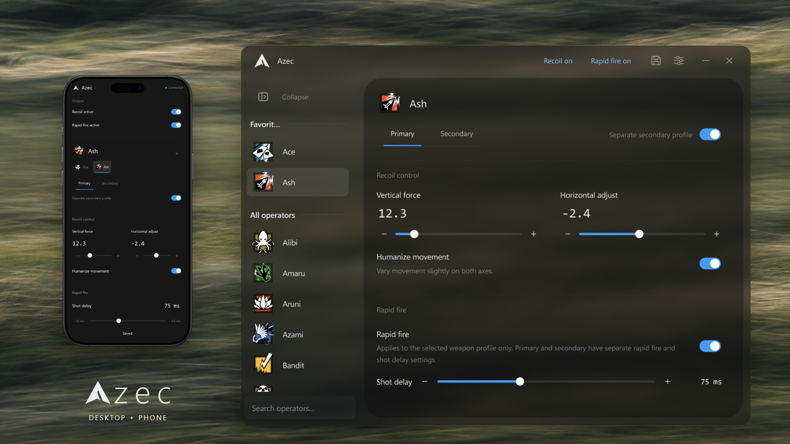

# Azec

**Open-source Rainbow Six operator and weapon profiles for Windows**, built with C++17 and Qt 6.

[](LICENSE)


Azec uses the **MonoCode** design with Dark and Light themes. The current application lives on `main`; experimental editions remain on separate branches.

A Windows desktop app for Rainbow Six recoil and rapid-fire profiles, with 78 operators, independent primary and secondary weapon settings, and a companion phone interface on your local network.

[Download Azec.exe](https://github.com/Azec-Zuckerberg/Azec/releases/latest/download/Azec.exe) · [Release history](https://github.com/Azec-Zuckerberg/Azec/releases) · [Application reference](docs/reference.md)



Current desktop and phone design, shown with example profiles. The download above is the published release; this image shows the current design.

## Get started

1. Download and open **Azec.exe**. It installs for your Windows user, adds Azec to Start, and opens the app. Qt and the Visual C++ runtime are included.
2. Complete the one-time [driver setup](#driver-setup) before using mouse output. Installing Azec itself does not require administrator rights; the driver setup and driver access require elevation.
3. Select an operator, adjust its primary profile, and click **Save**. Enable a separate secondary profile if you want different settings for the second weapon.
4. Turn on **Recoil** when ready. Fresh profiles have Rapid fire off; saved Rapid fire choices belong to each weapon profile.

Azec runs locally. Profile editing and phone control do not need a cloud account or internet connection. Driver downloads and update checks need internet access. Azec is an independent reconstruction of the original tool; real in-game behavior has not been verified.

## Driver setup

Azec uses **Interception** for relative mouse movement and rapid-fire output. Setup is intentional and performed once per PC. The driver is downloaded separately from the app.

Open **Settings → General → Interception driver** and follow the guide:

1. **Download and place** downloads the pinned official archive, verifies its SHA-256, and places the DLL in Azec's persistent data folder. Azec also verifies the DLL before copying or loading it, including manually downloaded and legacy copies. **Manual download** opens the upstream release if you prefer to download it yourself.
2. **Copy command** becomes available once Azec finds the verified installer and copies its command with the correct local path. Run it in an Administrator command prompt, then restart Windows.
3. **Restart as administrator** relaunches Azec with the access required by the driver.
4. **Check driver** refreshes its status. **Test driver** sends a short cursor movement to the right and back, allowing you to check output before opening the game.

The driver files remain under `%LOCALAPPDATA%\Azec\interception` across app updates. If setup fails, expand **If something fails** in the same guide. Error notices show an error code and **Copy error report**. Send that report when asking for help; a failed driver test includes the failed direction, selected mouse slot, slots exposing hardware IDs, administrator status, and the DLL's Windows error when available. **Driver detected** confirms the connection opened; use **Test driver** to check movement. Errors are also recorded locally in `azec.log` in the data folder.

## Profiles and output

Each operator has a primary profile and an optional secondary profile. Enabling the secondary copies the primary once; subsequent edits are independent. Disabling it keeps its settings for later. Selecting another operator starts on that operator's primary profile.

**Recoil** is a live switch shared by the desktop header, tray menu, and phone. It starts off when Azec opens. **Rapid fire** is saved per weapon profile, together with its shot delay. Switching weapons updates the displayed Rapid fire state. Shot delay ranges from 30 to 150 ms, with a slider and 5 ms adjustment buttons.

**Only in Rainbow Six** is enabled by default. It limits mouse output to when the game is focused. **Only while aiming** adds the aiming requirement to output. The panic shortcut is ignored while Azec is active.

Profile edits apply in memory immediately. Click **Save**, press **Ctrl+S**, or tap **Save changes** on the phone to keep them after restarting. Browsing operators does not mark profiles as edited. If saving fails, a persistent message explains the problem and your edits stay unsaved. Ordinary closing offers **Save / Discard / Cancel** when needed.

## Connect your phone

Use a phone browser on the same local network as the PC. Keep Azec running on the PC.

1. Open **Settings → Phone control** on the desktop.
2. Open the displayed PC address in your phone browser. Tap **Scan QR code** and photograph the revealed PC QR, or enter the six-digit pairing code. You can also scan the QR with your phone’s camera app or open the link from **Copy link**.
3. Select an operator and weapon profile on the phone, adjust settings, and tap **Save changes** to persist the edits.

The first phone card, **Output**, controls live **Recoil active**. The active weapon profile's **Rapid fire active** switch sits above its Rapid fire section. Shot delay stays on one line, and **− / +** adjust it by five milliseconds. Desktop and phone edit the same profiles and share the **Feedback sound** preference. QR photos are read on the phone and never uploaded; the LAN page opens the camera/photo picker rather than a live camera stream.

**Copy code** copies just the six digits. **Copy link** includes session access, so keep it private. **New code** rotates access and disconnects previously paired phones; restarting Azec also creates a new session. QR starts concealed and hides again when you leave Phone control or hide the app.

If the page does not open:

- Use the exact address displayed on the PC. `localhost` on a phone refers to the phone itself.
- Check that both devices can reach one another on the local network, and allow Azec on the Windows private-network firewall prompt.
- If the desktop reports that the server could not start, use **Retry**. The displayed address includes the actual selected port.

Phone access can be disabled in Settings. The page uses system fonts and bundled assets and does not require a separate phone app. Browser Add to Home Screen may provide a convenient shortcut; installation behavior depends on the browser.

## Personalize your workspace

Choose **Dark** or **Light** in **Settings → General → Theme**. Both follow the [monocode](https://github.com/hardbeat920/monocode) design language, with quiet hairlines and one blue accent. Both themes use a translucent window over system blur. Light pairs a pale gray shell with a white content panel. Your choice saves automatically, and the connected phone follows it. Changing the theme does not save or discard profile edits.

The sidebar stays expanded on the main page and in Settings. Right-click an operator to add or remove a favorite. Favorites appear once, above the remaining operators, with search above the roster.

Settings groups options into **General**, **Shortcuts**, **Phone control**, and **Profile backup**. Language and feedback sound are available in General.

## Profile backups

Open **Settings → Profile backup**. **Export backup** saves your profiles and supported settings to one file. Under **Import backup**, choose a backup file, review the summary, and confirm the import. Backups include favorites, the named profile library, and numeric sensitivity settings, and omit the machine-specific game-settings path.

Older backups preserve operators that were not included in them. Imported settings remain pending until **Save changes**; closing with **Discard** keeps the previously saved configuration.

## Default shortcuts

| Key | Action |
| --- | --- |
| Insert | Show or hide Azec |
| F6 | Toggle Recoil |
| 1 / 2 | Select primary or enabled secondary profile |
| Arrow keys | Adjust recoil by 0.1 while Azec is active, outside lists, text/number fields, and sliders |
| End | Panic exit, discarding unsaved edits |
| Ctrl+S | Save |
| Ctrl+F | Focus operator search |
| Esc | Leave Settings or clear search |

With the default game-focus preference enabled, show/hide, Recoil, and weapon shortcuts currently work while Rainbow Six or Azec is focused. Panic requires Rainbow Six to be focused and is ignored while Azec is active. Local editing shortcuts work in Azec.

Change bindings in **Settings → Shortcuts**. Show/hide, Recoil, and weapon bindings accept arrows, numpad, mouse side buttons, modifiers, and Windows keys. Duplicate bindings are rejected. Panic uses a more restricted key selection to avoid accidental exits. Shortcut changes save immediately without saving pending profile edits.

## Installation and updates

The download is a single-file installer. Program files normally live in `%LOCALAPPDATA%\Programs\Azec`; profiles, preferences, logs, and driver files live separately in `%LOCALAPPDATA%\Azec`. Use Azec from Start after installation; the downloaded EXE can then be deleted.

Azec checks for updates in the small startup window. If a newer release is available, the bar smoothly resets, shows download progress, and Azec installs the verified update and restarts before opening the main interface. Your saved settings are preserved. If the check cannot reach the server, a brief message appears and the app opens offline. If a confirmed update cannot be downloaded or verified, choose **Retry**. Automatic updates happen only at startup; **Settings → General → Updates → Check for updates** remains available for a manual check, with confirmation before installation.

For a first installation from a portable copy, put the new EXE beside the existing portable settings and `runtime` folder and run it after closing the old app. Settings are copied only when the installed store is empty; originals are retained. Use Profile backup for later transfers.

## Build from source

Requires **Windows x64**, Visual Studio 2022 C++ tools, a Windows SDK, Python, and **Qt 6.8.3 MSVC x64**.

```powershell
.\setup-qt.ps1
.\build.cmd
```

The setup script installs the pinned Qt kit in its standard location. Set `NEON_QT_ROOT` before building to select another compatible installation. The app uses qmake through `Azec.pro`. Build intermediates are written to `.build/`, with a root launcher and deployed files in `runtime/`.

`build.cmd checks` builds the separate verifier without executing it. Diagnostic commands and the isolation rules that keep desktop checks invisible are documented in [Testing](docs/testing.md).

### Package and publish

```powershell
.\share.cmd          # Build dist\Azec.exe with its runtime and licenses
.\share.cmd quick    # Repackage the existing share build
.\share.cmd publish  # Build, publish, and verify the public EXE
```

These commands do not run tests by default. The `test` argument includes the installer smoke test; `AZEC_SKIP_TESTS=1` still skips it.

Source and releases live together in this public repository. From a clean `main` checkout with your intended changes committed, run `.\build-and-push.ps1` (or `.\share.cmd publish`). It builds the installer, records its SHA-256, commits the generated version, pushes `main`, and publishes `Azec.exe` and `SHA256SUMS.txt` under a version tag targeting that source commit. It also publishes and verifies the identical files under the same release version in [Azec-releases](https://github.com/Azec-Zuckerberg/Azec-releases), preserving updates for existing installations. An authenticated GitHub CLI with write access to both repositories is required. Tests remain opt-in: use `-Test` or `share.cmd publish test` for the isolated installer smoke check.

`verify-release.ps1` checks the source tag, local installer, GitHub asset digests, and fresh anonymous downloads, including the stable latest-download link. If publication stops after building, use `build-and-push.ps1 -ResumeVersion <numeric-version>` with the original matching installer; existing assets are verified rather than replaced. See the complete [release workflow](AGENTS.md#releasing).

The app checks this repository for updates at startup. Older copies checking Azec-releases receive the same installer there and then follow this repository for future updates. Azec-releases remains available. The `unknown-cheats` edition keeps its separate offline startup and manual-update policy.

`package-release.ps1` creates the optional `dist/Azec-portable.zip` with an adjacent runtime. Both package formats exclude personal configuration, logs, pairing captures, stale executable backups, and verification executables.

## Contributing and security

Start with [Contributing](CONTRIBUTING.md) for setup, a code map, and guidance for your first focused change. Report ordinary bugs in [Issues](https://github.com/Azec-Zuckerberg/Azec/issues), and report vulnerabilities privately using the [security policy](SECURITY.md).

## License and attribution

Azec's original code is available under the [MIT license](LICENSE). Bundled third-party code, assets, and Qt retain their own licenses and notices in [licenses](licenses/). The MIT license does not replace those terms. Azec is an independent project and is not affiliated with Ubisoft.

## Documentation

- [Application reference](docs/reference.md): detailed behavior, storage, and phone control.
- [Agent instructions](AGENTS.md): project boundaries, compatibility, design, and delivery rules. [CLAUDE.md](CLAUDE.md) imports the same instructions.
- [Testing](docs/testing.md): diagnostic commands and the isolation they use.

The design reference is [monocode](https://github.com/hardbeat920/monocode), adapted from its web interface into Azec's native Qt controls. Azec's application-specific controls live in this repository.

Third-party notices for the design and sound references, operator icons, flags, Qt, and QR generation are retained in [licenses](licenses/). Qt is dynamically linked; pinned source references are [Qt Base 6.8.3](https://code.qt.io/cgit/qt/qtbase.git/tree/?h=v6.8.3) and [Qt SVG 6.8.3](https://code.qt.io/cgit/qt/qtsvg.git/tree/?h=v6.8.3). Phone device frames come from [weirdapps/mockups](https://github.com/weirdapps/mockups) under its [MIT license](licenses/iphone-mockup-MIT.txt); [frame sources and geometry](docs/showcase-assets/devices/SOURCE.md) describe the presentation assets.
