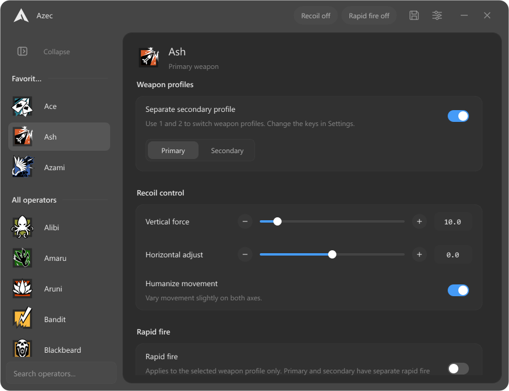
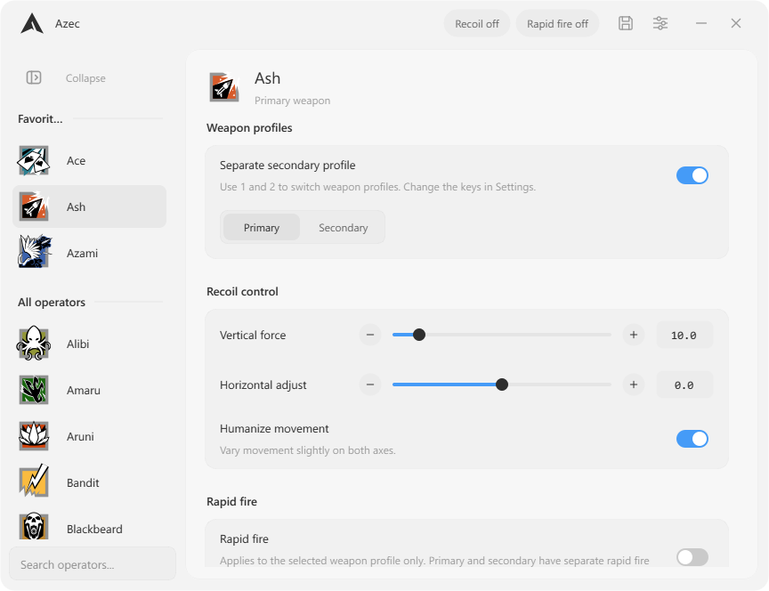

# Azec

This is the **MonoCode** branch: the desktop redesign with Dark and Light themes. The original Goofy interface remains on main; the download below is the published release.

A Windows desktop app for Rainbow Six recoil and rapid-fire profiles, with 78 operators, independent primary and secondary weapon settings, and a companion phone interface on your local network.

[Download Azec.exe](https://github.com/Azec-Zuckerberg/Azec-releases/releases/latest/download/Azec.exe) · [Release history](https://github.com/Azec-Zuckerberg/Azec-releases/releases) · [Application reference](docs/reference.md)

| Dark | Light |
| --- | --- |
|  |  |

Current MonoCode desktop, captured with example profiles. The download above is the published release; these screenshots show this branch.

## Get started

1. Download and open **Azec.exe**. It installs for your Windows user, adds Azec to Start, and opens the app. Qt and the Visual C++ runtime are included.
2. Complete the one-time [driver setup](#driver-setup) before using mouse output. Installing Azec itself does not require administrator rights; the driver setup and driver access require elevation.
3. Select an operator, adjust its primary profile, and click **Save**. Enable a separate secondary profile if you want different settings for the second weapon.
4. Turn on **Recoil** when ready. Fresh profiles have Rapid fire off; saved Rapid fire choices belong to each weapon profile.

Azec runs locally. Profile editing and phone control do not need a cloud account or internet connection. Driver downloads and update checks need internet access.

## Driver setup

Azec uses **Interception** for relative mouse movement and rapid-fire output. Setup is intentional and performed once per PC. The driver is downloaded separately from the app.

Open **Settings → General → Interception driver** and follow the guide:

1. **Download and place** downloads the pinned official archive, verifies its SHA-256, and places the DLL in Azec's persistent data folder. **Manual download** opens the upstream release if you prefer to download it yourself.
2. **Copy command** copies the installer command with the correct local path. Run it in an Administrator command prompt, then restart Windows.
3. **Restart as administrator** relaunches Azec with the access required by the driver.
4. **Check driver** refreshes its status. **Test driver** sends a short cursor movement to the right and back, allowing you to check output before opening the game.

The driver files remain under `%LOCALAPPDATA%\Azec\interception` across app updates. If setup fails, expand **If something fails** in the same guide.

## Profiles and output

Each operator has a primary profile and an optional secondary profile. Enabling the secondary copies the primary once; subsequent edits are independent. Disabling it keeps its settings for later. Selecting another operator starts on that operator's primary profile.

**Recoil** is a live switch shared by the desktop header, tray menu, and phone. It starts off when Azec opens. **Rapid fire** is saved per weapon profile, together with its shot delay. Switching weapons updates the displayed Rapid fire state. Shot delay ranges from 30 to 150 ms, with a slider and 5 ms adjustment buttons.

**Only in Rainbow Six** is enabled by default. It limits mouse output and application shortcuts to when the game is focused. **Only while aiming** adds the aiming requirement to output. The panic shortcut is ignored while Azec is active.

Profile edits apply in memory immediately. Click **Save**, press **Ctrl+S**, or tap **Save changes** on the phone to keep them after restarting. Browsing operators does not mark profiles as edited. If saving fails, a persistent message explains the problem and your edits stay unsaved. Ordinary closing offers **Save / Discard / Cancel** when needed.

## Connect your phone

Use a phone browser on the same local network as the PC. Keep Azec running on the PC.

1. Open **Settings → Phone control** on the desktop.
2. Open the displayed PC address in your phone browser and enter the six-digit pairing code. Alternatively, reveal and scan the QR code or open the link from **Copy link**.
3. Select an operator and weapon profile on the phone, adjust settings, and tap **Save changes** to persist the edits.

The first phone card, **Output**, controls live **Recoil active** and the active weapon profile's **Rapid fire active** setting. Desktop and phone edit the same profiles.

**Copy code** copies just the six digits. **Copy link** includes session access, so keep it private. **New code** rotates access and disconnects previously paired phones; restarting Azec also creates a new session. QR starts concealed and hides again when you leave Phone control or hide the app.

If the page does not open:

- Use the exact address displayed on the PC. `localhost` on a phone refers to the phone itself.
- Check that both devices can reach one another on the local network, and allow Azec on the Windows private-network firewall prompt.
- If the desktop reports that the server could not start, use **Retry**. The displayed address includes the actual selected port.

Phone access can be disabled in Settings. The page bundles its fonts and assets and does not require a separate phone app. Browser Add to Home Screen may provide a convenient shortcut; installation behavior depends on the browser. Phone images in this README are browser captures placed in device mockups.

## Personalize your workspace

Choose **Dark** or **Light** in **Settings → General → Theme**. Both follow the [monocode](https://github.com/hardbeat920/monocode) design language, with quiet hairlines and one blue accent. Both themes use a translucent window over system blur. Light pairs a pale gray shell with a white content panel. Your choice saves automatically, and the connected phone follows it. Changing the theme does not save or discard profile edits.

The sidebar remembers whether it is expanded or collapsed. Right-click an operator to add or remove a favorite. Favorites appear once, above the remaining operators. Search works in either sidebar state; selecting the compact search icon expands and focuses it.

Settings groups options into **General**, **Shortcuts**, **Phone control**, and **Profile backup**. Language and feedback sound are available in General.

## Profile backups

Open **Settings → Profile backup**. **Export backup** saves your profiles and supported settings to one file. Under **Import backup**, choose a backup file, review the summary, and confirm the import. Backups include favorites, sidebar state, the named profile library, and numeric sensitivity settings, and omit the machine-specific game-settings path.

Older backups preserve operators that were not included in them. Imported settings remain pending until **Save changes**; closing with **Discard** keeps the previously saved configuration.

## Default shortcuts

| Key | Action |
| --- | --- |
| Insert | Show or hide Azec |
| F6 | Toggle Recoil |
| 1 / 2 | Select primary or enabled secondary profile |
| Arrow keys | Adjust recoil by 0.1 while Azec is active, outside lists, text/number fields, and sliders |
| End | Panic exit, discarding unsaved edits |
| Ctrl+S | Save |
| Ctrl+F | Focus operator search |
| Esc | Leave Settings or clear search |

With the default game-focus preference enabled, show/hide, Recoil, weapon selection, and panic shortcuts require Rainbow Six to be focused. Local editing shortcuts work in Azec. Panic is ignored while Azec is active.

Change bindings in **Settings → Shortcuts**. Show/hide, Recoil, and weapon bindings accept arrows, numpad, mouse side buttons, modifiers, and Windows keys. Duplicate bindings are rejected. Panic uses a more restricted key selection to avoid accidental exits.

## Installation and updates

The download is a single-file installer. Program files normally live in `%LOCALAPPDATA%\Programs\Azec`; profiles, preferences, logs, and driver files live separately in `%LOCALAPPDATA%\Azec`. Use Azec from Start after installation; the downloaded EXE can then be deleted.

Open **Settings → General → Updates → Check for updates** to look for a newer release. Installation asks for confirmation, verifies the download's SHA-256, and preserves the data folder.

For a first installation from a portable copy, put the new EXE beside the existing portable settings and run it after closing the old app. Settings are copied only when the installed store is empty; originals are retained. Use Profile backup for later transfers.

## Build from source

Requires **Windows x64**, Visual Studio 2022 C++ tools, a Windows SDK, Python, and **Qt 6.8.3 MSVC x64**.

```powershell
.\setup-qt.ps1
.\build.cmd
```

The setup script installs the pinned Qt kit. Set `NEON_QT_ROOT` to select another compatible installation. The app uses qmake through `Azec.pro`. Build intermediates are written to `.build/`, with a root launcher and deployed files in `runtime/`.

**Do not run tests unless the user explicitly requests them.** Ordinary changes, bug reports, builds, and releases do not grant that permission. `build.cmd checks` builds the separate verifier without executing it. Authorized diagnostic commands and isolation requirements are documented in [Testing](docs/testing.md); the permission rule in [AGENTS.md](AGENTS.md) takes precedence.

### Package and publish

```powershell
.\share.cmd          # Build dist\Azec.exe with its runtime and licenses
.\share.cmd quick    # Repackage the existing share build
.\share.cmd publish  # Build, publish, and verify the public EXE
```

These commands do not run tests by default. The optional `test` argument requires an explicit request; `AZEC_SKIP_TESTS=1` still skips installer tests.

Publication uses the GitHub CLI, uploads only **Azec.exe** to [Azec-releases](https://github.com/Azec-Zuckerberg/Azec-releases), and runs `verify-release.ps1`. Verification matches the release version and GitHub asset digest with the local EXE and fresh anonymous downloads, including the stable download link. Source remains in the private Azec repository. Agents follow the complete [release workflow](AGENTS.md#releasing), including the source commit and push.

`package-release.ps1` creates the optional `dist/Azec-portable.zip` with an adjacent runtime. Both package formats exclude personal configuration, logs, pairing captures, stale executable backups, and verification executables.

## Documentation and attribution

- [Application reference](docs/reference.md): detailed behavior, storage, and phone control.
- [Agent instructions](AGENTS.md): project boundaries, compatibility, design, and delivery rules. [CLAUDE.md](CLAUDE.md) imports the same instructions.
- [Testing](docs/testing.md): commands for explicitly authorized diagnostics.

The design reference is [monocode](https://github.com/hardbeat920/monocode), adapted from its web interface into Azec's native Qt controls. Azec's application-specific controls live in this repository.

Third-party notices for the design and sound references, operator icons, flags, Qt, and QR generation are retained in [licenses](licenses/). Qt is dynamically linked; pinned source references are [Qt Base 6.8.3](https://code.qt.io/cgit/qt/qtbase.git/tree/?h=v6.8.3) and [Qt SVG 6.8.3](https://code.qt.io/cgit/qt/qtsvg.git/tree/?h=v6.8.3). Phone device frames come from [weirdapps/mockups](https://github.com/weirdapps/mockups) under its [MIT license](licenses/iphone-mockup-MIT.txt); [frame sources and geometry](docs/showcase-assets/devices/SOURCE.md) describe the presentation assets.
