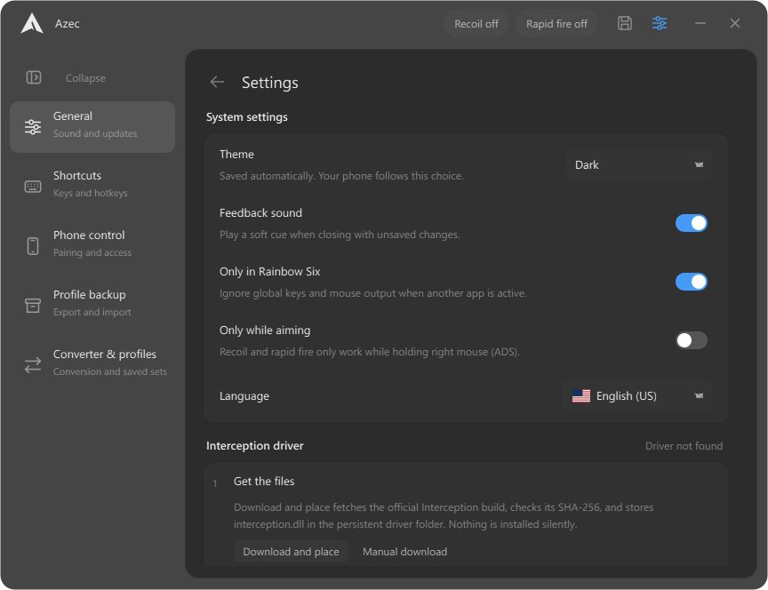
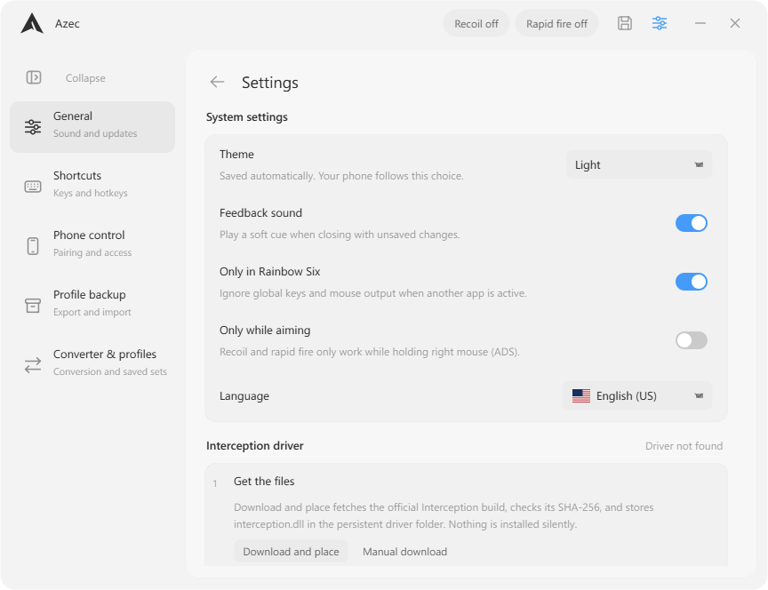

# Application reference

Detailed interface, persistence, phone, and input behavior. For setup, see the [README](../README.md).

## Overview

C++ / Qt 6 desktop interface for the recovered R6 behavior. The Azec window is 864 × 664 at 100% display scale, with screen-fit sizing at higher scales, custom window controls, and Settings inside the main window. Azec has a 200 px operator sidebar.

The interface follows the monocode design language (github.com/hardbeat920/monocode), rebuilt natively in Qt: Dark and Light themes with a shared blue accent (`#459BF7`); Dark uses a `#171717` surface, `#EBEBEB` ink, and a translucent window over system acrylic, hairline separators, and translucent content fills instead of opaque cards. Both pages live inside one stationary rounded panel with a 1 px hairline. Opening Settings replaces the operator roster in the sidebar with a quick-link rail — General, Shortcuts, Phone control, and Profile backup — drawn as quiet monochrome line icons. Expanded links show the icon, name, and a one-line description; the collapsed sidebar shows icons only with tooltips. The selected link is a soft content-tinted pill, and the settings content crossfades over 160 ms. Controls use the Windows system face (Segoe UI, 13 px base and medium-weight rows, 12 px descriptions at 45% ink with 1.625 line spacing) with Consolas for numeric and connection details; operator rows are 52 px tall with 14 px names and 44 px icons, and selection is a content-tinted pill. Section headings sit above quiet row groups, matching MonoCode's settings composition. The Azec wordmark is simple semibold text beside the app mark in the slim header. All header controls use centered 20 px vector icons inside matching 34 px hit targets and stay flat until pressed, focused, or selected. The header also carries separate Recoil and Rapid fire status pills. Clicking switches does not add an outer focus ring; keyboard navigation keeps a 1.5 px accent outline. Switches are quiet pills — a 20% content well when off, the accent when on, with a plain white knob. Sliders use thin content-tinted tracks with light handles in Dark and dark handles in Light; numeric fields use the selected theme’s content fill with an accent focus ring. Window corners are painted antialiased at a 16 px radius over the glass — the acrylic blur shows through the rounded notches, and corners square off while maximized — the panel uses a 16 px radius, and buttons use 6 px corners and inputs use 8 px corners. Operator changes apply a gentle 120 ms fade only to the new icon and name; the selected profile and controls update immediately, including during rapid switching. The Save/Discard/Cancel and Quick Guide dialogs use the same hairline border and 14 px corners as the hotkey dialog.

## Appearance and settings

The MonoCode layout is the only desktop and phone presentation, with Dark and Light themes selected in General. The obsolete `interface` and `colorTheme` preferences are ignored and removed on the next successful UI-preference save, preserving favorites and the collapsed-sidebar preference.

Settings groups its controls into General, Shortcuts, Phone control, and Profile backup. General holds Theme, language, feedback sound, **Only in Rainbow Six**, **Only while aiming**, the Interception driver guide, and Updates; Shortcuts groups the five bindable actions into Application controls and Weapon selection, with descriptions and adjacent key controls; Phone control holds access, address, pairing code, and the QR; Profile backup holds export and import. Changing categories retains edits and conceals any revealed pairing QR when leaving Phone control.

The dark theme follows MonoCode's inset layout: `#0d0d0d` at 80% plus a 5% content wash over acrylic. The content pane adds `#060606` at 40%, so wallpaper colours stay subdued. Settings group fills use content at 3%; shell separators use 4%. The window never repaints on cursor movement, since through the acrylic blur every repaint must recompose the glass. The phone page receives the same tokens through the state's `appearance.colors` and follows the desktop look automatically, including through state polling while a number is being edited. Theme changes never change or save weapon settings and need no restart.

The **Collapse** button at the top of the sidebar animates between its expanded 200 px width and a compact 76 px icon rail. Operator names remain available as tooltips. A star shortcut appears above the operator icons in compact mode when favorites exist. Search stays at the bottom. Its icon in the compact rail expands the sidebar and focuses the search field after the animation. Favorites, filtering, selection, and right-click actions work in either state. The hidden group headers no longer reserve blank space in compact mode. Rapid toggles reverse from the current width. `sidebarCollapsed` persists in `azec_ui.json`, preserving favorites; invalid or missing values fall back to the expanded sidebar. Failed writes retain the previous state and show an error.

In both themes on Windows 10, moving or resizing the desktop window temporarily uses lighter native blur with the same translucent fills. Acrylic returns when the move/resize ends, including cancellation, or the window hides. The native material changes only at those boundaries; moving the cursor does not trigger material changes or full-window repaints. Windows 11 retains its existing effect.

Light uses MonoCode’s colors over the same translucent glass depths as Dark: a `#f5f5f5` shell at 80% with a 1% dark wash, a white panel at 40%, `#2e2e2e` content, and softer 6% selection fills. Native glass stays active in both themes. Theme changes crossfade two cached foregrounds over 160 ms without disabling and re-enabling native blur. On Windows 10, grabbing the window switches immediately to the lighter native blur; releasing it restores acrylic. Move/resize material changes have no cover, snapshot overlay, fade, or delay. General’s Theme choice applies immediately and saves atomically as `theme` in `azec_ui.json`, preserving favorites, sidebar state and pending profile edits. Missing or invalid choices default to Dark; the obsolete `colorTheme` key remains ignored. Theme is local to this PC and is not changed by profile imports. The phone follows the desktop’s scheme and color tokens, including slider handles, status colors and browser chrome.

The desktop layout is built in `src/desktop_layout.hpp`. Bindings and application services remain in `MainWindow`.

## Screenshots

| Dark | Light |
| --- | --- |
|  |  |

The current MonoCode desktop: a seamless header, a 200 px operator sidebar, and matching controls in both themes. Captured with isolated example profiles.

| Dark settings | Light settings |
| --- | --- |
|  |  |

## Run

Double-click **Azec.exe** for the shared single-file build. The optional portable zip also includes **Run.cmd**.

The shared **`dist\Azec.exe`** installs for the current Windows user: program files and licenses go under the Windows per-user Programs folder (normally `%LOCALAPPDATA%\Programs\Azec`), and a Start menu shortcut opens the installed launcher. All configuration files, favorites, logs, and the instance lock live in **`%LOCALAPPDATA%\Azec`**. Nothing is unpacked beside the download, and the downloaded EXE is no longer needed after installation. First installation can copy profiles from an existing portable folder beside the downloaded EXE; originals are retained, and any existing installed profile set takes priority. Close the old portable copy before importing. Development and optional portable zip builds keep their existing adjacent runtime and profiles.

Settings → General → Updates checks the public releases repository anonymously and asks before downloading. The complete EXE must match the published SHA-256 before execution. Updates wait for the old app to exit and prepare a versioned runtime before replacing the installed launcher. The data folder is untouched; one previous runtime is retained. Launching an older downloaded installer opens the newer installed app. The optional portable zip is produced by `package-release.ps1`, with its launcher, runtime, licenses, and no personal data.

- **Insert:** show or hide the window.
- **F6:** toggle recoil activity; starts OFF. The header keeps a **Recoil** switch and a **Rapid fire** switch for the active weapon profile. The old Master enable gate is removed; rapid fire is stored separately for primary and secondary.
- **End:** immediate panic exit; unsaved edits are discarded. It is ignored while Azec is the active window or a text/number field is focused. With **Only in Rainbow Six** enabled (the default), it also requires the game to be the foreground window.
- **1 / 2:** select primary / secondary weapon when separate profiles are enabled for that operator. Both keys can be changed in Settings. Show/hide, recoil-toggle, and weapon bindings accept any key you choose; duplicate bindings are rejected with an “already used” message. The panic shortcut keeps a stricter safe-key filter.
- Arrow keys make 0.1-step recoil adjustments while this window is active and a text/number field or list is not focused.

Click an operator's icon/name to edit its profile. Right-click an operator for a compact Favorite / Remove favorite context-menu action with an outlined star. There is no nested push button; the action's quiet hover stays inset from the menu edge. Favorited operators move out of All operators into Favorites and return when unfavorited; each operator appears once. Both groups share one scrolling sidebar and follow the search field. The entire Favorites group is hidden when empty or when none match the search, with no placeholder or reserved space. Favorites save automatically to `azec_ui.json` in the active configuration directory and reload on startup. Selecting an operator persists only the selection, so browsing the roster is not an unsaved profile edit.

Enable **Separate secondary profile** on an operator to add independent secondary recoil, humanization, and shot-delay settings. The first secondary profile starts as a copy of that operator's primary settings. Use the Primary / Secondary buttons or the configurable 1 / 2 keys to switch. Disabling secondary mode restores the primary profile and keeps the secondary edits for later. Selecting another operator starts on primary. Weapon shortcuts ignore number/text editing and Ctrl/Alt/Windows-key combinations.

The operator heading shows the name once, with compact Primary / Secondary tabs and the **Separate secondary profile** switch in one row below it. On narrow phone screens, the switch wraps onto the next row. Both tabs stay visible; Secondary is dimmed until its separate profile is enabled. The selected tab has an accent underline that fades over 140 ms on desktop. Profile changes apply immediately.

## Stored profile libraries

The Converter & profiles Settings page has been removed. Existing named sets, the active set, and sensitivity metadata remain in saved data and backups. Desktop and phone continue editing the same active engine configuration. Profile backup still exports and restores this data; older backups preserve library entries they do not contain. The binary layout remains 3,734 bytes.

## Output switches

Azec has one Recoil switch and one Rapid fire toggle for the active weapon profile:

| Switch | Where | Persisted | Notes |
| --- | --- | --- | --- |
| **Recoil** | Header pill, tray, phone Output card | No; starts off every launch | Live while enabled. The header pill and the F6 binding both toggle it. |
| **Rapid fire** | Header pill, tray, phone Output card, Rapid fire card | Yes, per profile in `azec_weapons.json` | Applies to the active weapon profile only; primary and secondary are independent. Each profile keeps its own shot delay, from 30 to 150 ms. |

The old **Master enable** switch is gone. Legacy files that still contain it keep loading, but the value no longer gates anything. Rapid fire is the per-profile `rapid` flag: primary and secondary each keep their own state. Older sidecars with a single `rapidActive` value migrate that value onto every primary and secondary profile on load, and new saves mark the file with `perProfileRapid`.

Recoil uses a 12 ms step while the active profile's rapid fire is off and a 30 ms step while it is on. Both controls are reachable from the phone, the tray, and the operator page; Recoil is shared, while Rapid fire follows the active weapon profile on every surface.

## Only in Rainbow Six

**Settings → General → Only in Rainbow Six** is on by default. While it is on:

- Application shortcuts (show/hide, recoil toggle, primary/secondary selection, panic) only fire while the Rainbow Six process is the foreground window.
- Mouse output — recoil movement and rapid fire — is suppressed while any other application is focused, and while Azec itself is active.
- The panic key is ignored while Azec, one of its dialogs, or a dropdown is active, so End keeps its normal meaning in lists and dialogs.

Azec recognizes foreground executable names beginning with `RainbowSix`, excluding names containing `_BE`, with a fallback for window titles containing “Rainbow Six”. Recognition is cached until the foreground window changes; the desktop polling loop shares its result with the input workers. The preference is stored in `azec_weapons.json`. Turn it off in Settings → General only if you deliberately want system-wide behavior. The gate prevents accidents in other applications; it does not change how the game or its anti-cheat behaves, and it is not a claim of undetectability.

Show/hide, recoil-toggle, and weapon bindings accept any key you choose, including arrows, the numeric keypad, mouse side buttons, modifiers, and Windows keys. Pressing a duplicate key is rejected with an “already used” message instead of being blocked as unsafe. The panic shortcut keeps a stricter safe-key filter: it rejects mouse buttons, lone modifiers, Windows keys, ordinary typing, and common punctuation.

## Keyboard and pointer behavior

| Key | Action |
| --- | --- |
| Ctrl+S | Save the configuration |
| Ctrl+F | Focus the operator search field |
| Esc | Leave Settings, or clear the search field |
| Arrow keys | 0.1 recoil adjustments while the operator page is focused and no text field, list, or slider owns the keyboard |

Arrow keys reach a focused operator list again, so the roster can be browsed without a mouse; the list draws a focus ring when it owns the keyboard. The mouse wheel over a slider, number field, or dropdown scrolls the page instead of silently changing a value, unless the control already has focus.

## Sounds

Interaction sounds are generated in-app as ports of the cuelume recipes monocode uses, honoring the **Feedback sound** switch in Settings → General: switches and output toggles play a mechanical click-clack, copy actions play a quick three-step scan tone, and explicit saves play a short ascending confirmation. Recoil and rapid-fire changes made from hotkeys or the tray are silent. Closing with unsaved changes plays a calm muted knock with two descending tones before the Save/Discard/Cancel prompt appears, and dry-run fixtures never play sounds.

The Save button stores primary settings in the original compatible `r6_config.bin` and secondary profiles, per-weapon rapid-fire flags, weapon keys, the phone-access preference, the game-focus preference, and newer-operator profiles and selection in `azec_weapons.json`. Primary saves write and flush a temporary file before replacing the destination; the JSON sidecar is prepared first and only committed after the binary write succeeds. If the sidecar commit fails after the binary write, the previous binary bytes are restored so the two files cannot disagree. Failed saves show a persistent message card instead of only changing the icon; edits remain pending and Save can be retried. Rejected primary configurations are preserved as `r6_config.corrupt-<timestamp>.bin` with a visible notice. Read/preservation failures block saving to protect the existing file.

Desktop and phone messages use compact cards centered inside the app/page, with a neutral paper surface, a small status badge, and an **Understood** button. They do not take keyboard focus, dim the page, or slide down from the header. Errors stay until acknowledged or resolved. Ordinary success/information messages dismiss after five seconds; persistent desktop guidance stays until acknowledged. Escape dismisses the desktop card before leaving Settings. A routine desktop success does not replace a visible save failure. Long messages scroll within the card.

Only one instance may use a configuration directory. Launching another copy brings the existing window forward; a lock file whose owning process is gone is reclaimed automatically, and a lock that cannot be used at all is reported in a dialog instead of failing silently. Separate fixture directories remain independent. A tray icon offers Open/hide, Recoil active, Rapid fire active, and Exit. Ordinary closing asks Save / Discard / Cancel when changes are unsaved and plays the calm refusal cue; failed saves keep the app open. Every nonempty hotkey must be unique across the five bindable actions (open/hide, recoil toggle, panic exit, primary weapon, secondary weapon).

Settings → Profile backup exports all primary profiles, secondary profiles, per-weapon rapid-fire flags, favorites, the collapsed-sidebar choice, the game-focus preference, and persisted preferences into one versioned JSON file. The page separates **Export backup** and **Import backup** into explained actions. Import validates the complete backup, then shows its filename, operator count, scope, and Save/Discard guidance before asking for confirmation. Cancel leaves the working profiles untouched. Imported profiles, favorites, and sidebar state stay in memory until Save is clicked. Discard leaves their saved values intact. Saving stages all three files and restores previous profile files if committing imported UI preferences fails. Outside a pending import, favorites retain their normal automatic persistence. A valid import also points the sidebar at the imported operator instead of leaving the previous row highlighted. Older backups that still carry a color theme are accepted; that key is ignored and removed on the next save.

## Phone control

The advertised pairing address prefers an active physical Wi-Fi or Ethernet adapter, with a gateway preferred among physical adapters. A physical LAN without a gateway still ranks above a VPN or virtual adapter. Internal virtual switches without a gateway are excluded, so Hyper-V/WSL adapters cannot displace the PC's reachable LAN address. Both Copy link and the QR use this selection.

Desktop Settings uses a translucent dark language popup and a framed hotkey dialog with wrapped instructions and Cancel. The phone uses matching language, operator, and hotkey pickers, with search for keys/operators, keyboard navigation, and Escape to dismiss. Duplicate hotkeys keep the previous binding and show the validation error without marking a working connection offline. Fresh settings and the unpaired phone page default to English; the paired page follows the saved desktop language. Existing preferences and language IDs remain compatible (Portuguese 0, English 1).

The app starts a local HTTP server automatically. In desktop **Settings → Phone control**, find its Wi-Fi address and six-digit pairing code. On an Android phone or iPhone connected to the same local network, open that address in a modern browser and enter the code. **Copy code** copies only the six digits; **Copy link** includes a session token to skip code entry. **New code** rotates the code and token and disconnects paired phones. The address normally uses port 18764; the app selects another available port if needed, and Settings shows the actual address. `localhost` on the phone refers to the phone itself, so use the PC address shown in Settings.

The QR card starts blurred. Click it, or focus it and press Space, to reveal the same session link used by Copy link. Click again to conceal it. Leaving Settings, hiding the window, or changing the network address conceals it automatically. QR generation is entirely local, using bundled Project Nayuki code. The host allow-list is cached and refreshed every 2.5 seconds; Settings and QR address changes are detected on the same timer.

The QR fills its existing card with pixel-aligned squares in a dark version of the fixed accent, with at least 7:1 contrast against white. The symbol uses the largest whole-pixel cell size that still keeps the standard four-module white quiet zone on every side; the card supplies that margin, and the QR remains unbranded: its full pattern continues through the center without a logo or blank cutout. Quartile error correction keeps normal pairing links less dense; the encoder boosts correction to High when it fits without increasing the symbol size. A texture refresh keeps the same encoded link. Click reveal/conceal animates the colour-preserving blur over 420 ms and can reverse mid-animation. Blur textures are prepared off the GUI thread, with a gradual detail reveal and no image filtering during painting. Automatic concealment is immediate. Phone-access toggles expand/collapse only the connection details over 300 ms without rebuilding Settings or resetting its scroll position; disabling access stops the server immediately. The transition uses a transparent cached surface, keeps the toggle row stationary, and preserves the displayed height when reversed. If the server cannot start, a **Retry** button and a persistent notice appear instead of a silent failure.

The MonoCode-inspired Azec tile mark appears beside the desktop wordmark, in the window and tray icons, in the Windows launcher/runtime file icons, and on the phone page and home-screen shortcut. Its editable vector sources are `assets/logo.svg` and `assets/app-icon.svg`.

See [testing.md](testing.md) for optional rendered QR decoding checks.

The phone page edits the same in-memory profiles and application settings as the desktop, including both weapon slots. The top **Output** card has the **Recoil active** switch and the active weapon profile's **Rapid fire active** switch. **Only while aiming** lives in the collapsed Settings section. Tap the operator identity to open a scrollable icon grid with saved desktop Favorites above All operators; search opens the keyboard only when tapped. Favorites also appear as one-tap shortcuts below the operator identity, with no separate favorite-edit button. The **Weapon profiles** disclosure holds the independent secondary-profile option. Shot delay uses a 30–150 ms slider with **−5 ms / +5 ms** buttons on both desktop and phone; its value field is read-only. Changes apply immediately; the sticky **Save changes** button keeps them after restarting and finishes any pending slider edits before saving. It refreshes desktop changes while you are not editing an input and pauses polling while the page is hidden. It uses system fonts and has no external fonts, libraries, or internet dependency. Keep the PC app running. If Windows requests network permission, allow the app on the private network used by the phone.

Phone access can be disabled in Settings. Pairing codes and tokens change when the app restarts. API calls require the session token, pairing attempts are rate-limited, and foreign origins/hosts are rejected. The app does not configure router forwarding or expose a public service. This HTTP control page is intended for a trusted local network.

Pairing throttling uses a bounded, expiring per-IP table and a monotonic 60-second window. It does not block correctly authenticated requests. Pairing codes and bearer tokens use a fixed-work comparison for equal-length values. The phone page follows the selected desktop language (English, Portuguese, French, Spanish, German, Arabic, Hebrew, Chinese, Japanese) and retains its token only in browser session storage.

The page includes a manifest, standalone-mode hints, and locally generated home-screen icons; the manifest uses the fixed dark colors. Use your browser's Add to Home Screen action where available. Full PWA installation/promotion depends on the browser and its HTTPS requirements; a LAN HTTP address cannot guarantee it. The PC app and local network are still required, even when opening a home-screen shortcut.

The sidebar, operator controls, and Settings use fading scrollbars. They start invisible, fade in when scrolling, and fade out after three seconds without scrolling. Dragging keeps them visible until three seconds after release. Their narrow lanes remain reserved so fades never move the content. Wheel notches glide to their target over about 130 ms instead of jumping, repeated notches keep their momentum, and precision-touchpad pixel deltas scroll one-to-one. All three scroll views have clean, unobscured edges with no painted fades over the content.

The Save icon beside the gear stays neutral ink when saved and uses the current accent while settings are unsaved. It stays flat with the same artwork and transparent background, without a glow or pulse. Failed saves retain the unsaved accent and show a persistent banner with the error; successful saves restore neutral ink. The main window has no footer strip. The header shows two separate pills, **Recoil** and **Rapid fire**; the recoil toggle hotkey remains configurable, while rapid fire is switched from the header, tray, or phone for the active weapon profile. The gear opens an inline Settings page for hotkeys, language, sound, game focus, and the quick guide. The back arrow, gear, or an operator selection returns to the operator page. Changing operators preserves unsaved profile edits in memory and persists only the selection. Hotkey assignments save immediately, matching the recovered behavior.

Settings use `r6_config.bin` in the active configuration directory: `%LOCALAPPDATA%\Azec` for the installed app, or the working folder for development/portable runs. Existing valid files remain compatible. Legacy accent and radius values are normalized on load to fixed compatibility values; the visible look is fixed and no longer reads a theme preference. The next save writes the normalized binary values.

Every operator (78 in total, Ace through Denari) has a real embedded SVG icon, without generated tiles or initials placeholders, and supports an optional secondary weapon profile. Most icons come from the supplied operator folder; Ace uses its real icon from [r6operators](https://github.com/marcopixel/r6operators/tree/master/operators/ace), and Noor, Nomad, Zofia, Zero, Rauora, Solid Snake, and Denari use the maintained [zerobertoo/r6operators](https://github.com/zerobertoo/r6operators/tree/master/operators) fork. The Downloads folder is not needed at runtime. Extension profiles and selection persist in `azec_weapons.json`, so `r6_config.bin` keeps its exact 3,734-byte layout.

Desktop text uses the Windows system face (Segoe UI) with Consolas for numeric and connection details; no fonts are bundled. The design and sound systems are adapted from monocode and cuelume, with their MIT notice in `licenses/monocode`; operator icon licenses are retained in `licenses/r6operators`.

Desktop application strings live in `src/strings.hpp` (lookup and enum), one table per language in `src/lang_*.hpp` (English, Portuguese, French, Spanish, German, Arabic, the Arabic "Free Palestine" prank behind the Hebrew picker entry, Simplified Chinese, Japanese), and bundled flag SVGs selected by `src/flags.hpp`; picking Hebrew shows the Israel flag, then reveals a Free Palestine popup with the Palestine flag and switches every label to Arabic prank text. Portuguese and the other seven non-English languages also relabel the bundled Qt file dialogs in `strings.hpp`. The phone dictionary in `assets/phone.html` covers the same languages, with RTL layout for Arabic and the Hebrew prank entry. Favorites now include schema version 1 while still accepting existing unversioned files. Save/server/profile-load diagnostics go to `azec.log`, capped at 256 KiB with one rotated backup. Request bodies and pairing secrets are never logged. The window repaints only when content changes; operator pixmaps share a bounded Qt cache.

## Mouse output

Movement and rapid fire use the dynamically loaded **Interception** backend, sending relative integer X/Y deltas and left-button strokes. Its DLL lives under the persistent Azec data folder in `interception`, outside the versioned program runtimes. Legacy adjacent DLLs are migrated during installation or loading; system-directory copies remain supported. The official setup archive, x64 DLL, and installer have pinned SHA-256 hashes. Every DLL candidate must match before copying or loading, including manual, legacy, and system-directory copies. Loading holds the verified file and its resolved parent directories against replacement and searches only Windows system directories for dependencies. The guide enables Copy command only for a verified installer. Unsupported or modified DLLs remain unavailable; use Download and place to recover. The workers only inject input when the **Only in Rainbow Six** gate allows it and Azec itself is not active; the gate is on by default.

The recovered fractional accumulation, shared X/Y humanization jitter, 12/30 ms recoil intervals, and rapid-fire sequence (up → 5 ms → down → 25 ms → up → configured delay clamped to 30-150 ms) remain in the C++ engine. The 30 ms recoil interval is now tied to the active profile's Rapid fire flag; otherwise recoil uses 12 ms. The unused Logitech DLL lookup was removed. Idle recoil checks wait 8 ms while disabled and 4 ms while awaiting a press; idle rapid-fire press checks wait 4 ms. This may add a few milliseconds to first-press detection; active movement/fire timings are unchanged. Real input latency has not been measured in-game. The gate prevents output in other applications but does not make a game macro compliant with game rules or anti-cheat.

Country flag artwork is bundled unchanged from [flag-icons v7.3.2](https://github.com/lipis/flag-icons/tree/v7.3.2), with the MIT license in `licenses/flag-icons/`. The language picker preserves the original emblems, stars, and Arabic script rather than approximating them in code.
