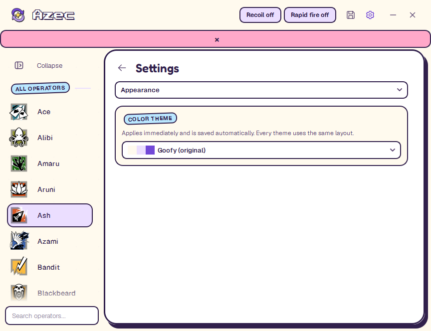
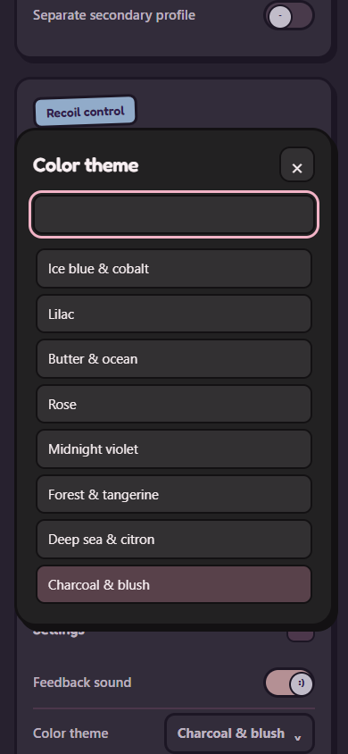

# Application reference

Detailed interface, persistence, phone, and input behavior. For setup, see the [README](../README.md).

## Overview

C++ / Qt 6 desktop interface for the recovered R6 behavior. The Goofy window is 864 × 664 at 100% display scale, with screen-fit sizing at higher scales, custom window controls, and Settings inside the main window. Goofy has a 200 px operator sidebar.

The default interface follows GoofyUI (github.com/Azec-Zuckerberg/goofy-ui-library): Charcoal & blush materials by default (`#222122` canvas, `#323032` surfaces, `#F8EFF2` ink), with chunky 2-3 px outlines, flat colour, and hard offset ink shadows instead of blur. Live state uses the palette accent (`#F2B3C6` in Charcoal & blush). Both pages live inside one stationary rounded panel with a 3 px ink outline. Opening Settings replaces the operator roster in the sidebar with a quick-link rail — General, Appearance, Shortcuts, Phone control, and Profile backup — drawn as flat sticker-colour icons with a thick ink outline. Expanded links show the icon, name, and a one-line description; the collapsed sidebar shows icons only with tooltips. The selected link is a lavender pill with an ink outline, and the settings content crossfades over 180 ms. Controls use bundled Geist (13 px base, 14 px rows) with Fredoka display headings; operator rows are 52 px tall with 14 px Geist names and 44 px icons, and selection is a lavender pill with an ink outline. Group and section headings are GoofyUI stickers: slightly tilted colour chips with ink outlines. The Azec wordmark is rendered in the bundled Press Start 2P pixel font — chunky white pixel lettering with a hard ink outline and shadow inside the spacious header. All header controls use centered 20 px vector icons inside matching 34 px hit targets and stay flat until pressed, focused, or selected. The header also carries separate Recoil and Rapid fire status pills. Clicking switches does not add an outer focus ring; keyboard navigation keeps a 2 px accent outline. Switches are GoofyUI face toggles — lavender when off, accent when on, with a white knob showing `-` or `:)`. Sliders use lavender pill tracks with white ink-rimmed handles, and numeric fields are yellow mono chips. Window corners have a 24 px radius, panel corners 24 px, and buttons and inputs use 10-18 px corners. Operator changes apply a gentle 120 ms fade only to the new icon and name; the selected profile and controls update immediately, including during rapid switching. The Save/Discard/Cancel and Quick Guide dialogs use the same 3 px ink border and 24 px corners as the hotkey dialog.

## Appearance and settings

Goofy is the only desktop and phone presentation. Older interface preferences are ignored and removed on the next successful UI-preference save, preserving themes, favorites, and the collapsed-sidebar preference.

Settings groups its controls into General, Appearance, Shortcuts, Phone control, and Profile backup. General holds the feedback-sound switch and the **Only in Rainbow Six** preference; Appearance shows the ten color themes as preview cards; Shortcuts lists the five bindable actions; Phone control holds access, address, pairing code, and the QR; Profile backup holds export and import. Changing categories retains edits and conceals any revealed pairing QR when leaving Phone control.

Goofy offers ten fixed color palettes in Appearance: Charcoal & blush (the default for fresh configurations), Goofy (original), Pistachio & coral, Ice blue & cobalt, Lilac, Butter & ocean, Rose, Midnight violet, Forest & tangerine, and Deep sea & citron. All ten previews sit directly on the page in a three-column grid, with names below and no surrounding cards or section box. Each preview shows the Azec lettering, a slider, a face toggle, and a yellow number chip in that palette. The selected preview has an accent outline and a check beside its name. Clicking a preview applies and saves it immediately. These change the canvas, surfaces, header, accent, selection, and text colors while retaining one layout. Theme changes apply immediately and save automatically; they do not change weapon settings or require a restart. The phone offers the same choices in **Settings → Color theme**. Either screen updates the same preference: the phone uses the desktop palette for its canvas, cards, text, outlines, and controls. Other connected phones follow through the existing state polling, including while a number is being edited. The header always matches the sidebar canvas, without a divider.

The **Collapse** button at the top of Goofy's sidebar animates between its expanded 200 px width and a compact 76 px icon rail. Operator names remain available as tooltips. A star shortcut appears above the operator icons in compact mode when favorites exist. Search stays at the bottom. Its icon in the compact rail expands the sidebar and focuses the search field after the animation. Favorites, filtering, selection, and right-click actions work in either state. The hidden group headers no longer reserve blank space in compact mode. Rapid toggles reverse from the current width. `colorTheme` and `sidebarCollapsed` persist in `azec_ui.json`, preserving favorites; invalid or missing values fall back to the original theme and expanded sidebar. Failed writes retain the previous state and show an error.

The desktop layout is built in `src/desktop_layout.hpp`. Bindings and application services remain in `MainWindow`.

## Screenshots

The desktop window: a seamless header with the pixel-font Azec wordmark, the 200 px operator sidebar, and operator settings with GoofyUI sticker headings and fully round slider handles.

The paired phone page reuses the same GoofyUI materials: cream canvas, white cards with chunky ink outlines and hard offset shadows, sticker section chips, yellow number chips, and face toggles. The first card is **Output**, with the Recoil switch and a Rapid fire switch for the active weapon profile.

The hotkey dialog keeps the action and key instructions readable, with explicit cancellation.

The phone language picker stays inside the page and follows the same GoofyUI materials.

## Run

Double-click **Azec.exe** for the shared single-file build. The optional portable zip also includes **Run.cmd**.

The shared **`dist\Azec.exe`** installs for the current Windows user: program files and licenses go under the Windows per-user Programs folder (normally `%LOCALAPPDATA%\Programs\Azec`), and a Start menu shortcut opens the installed launcher. All configuration files, favorites, theme, logs, and the instance lock live in **`%LOCALAPPDATA%\Azec`**. Nothing is unpacked beside the download, and the downloaded EXE is no longer needed after installation. First installation can copy profiles from an existing portable folder beside the downloaded EXE; originals are retained, and any existing installed profile set takes priority. Close the old portable copy before importing. Development and optional portable zip builds keep their existing adjacent runtime and profiles.

Settings → General → Updates checks the public releases repository anonymously and asks before downloading. The complete EXE must match the published SHA-256 before execution. Updates wait for the old app to exit and prepare a versioned runtime before replacing the installed launcher. The data folder is untouched; one previous runtime is retained. Launching an older downloaded installer opens the newer installed app. The optional portable zip is produced by `package-release.ps1`, with its launcher, runtime, licenses, and no personal data.

- **Insert:** show or hide the window.
- **F6:** toggle recoil activity; starts OFF. The header keeps a **Recoil** switch and a **Rapid fire** switch for the active weapon profile. The old Master enable gate is removed; rapid fire is stored separately for primary and secondary.
- **End:** immediate panic exit; unsaved edits are discarded. It is ignored while Azec is the active window or a text/number field is focused. With **Only in Rainbow Six** enabled (the default), it also requires the game to be the foreground window.
- **1 / 2:** select primary / secondary weapon when separate profiles are enabled for that operator. Both keys can be changed in Settings. Show/hide, recoil-toggle and panic shortcuts reject ordinary typing and list-navigation keys.
- Arrow keys make 0.1-step recoil adjustments while this window is active and a text/number field or list is not focused.

Click an operator's icon/name to edit its profile. Right-click an operator for a compact Favorite / Remove favorite context-menu action with an outlined star. There is no nested push button; the action's quiet hover stays inset from the menu edge. Favorited operators move out of All operators into Favorites and return when unfavorited; each operator appears once. Both groups share one scrolling sidebar and follow the search field. The entire Favorites group is hidden when empty or when none match the search, with no placeholder or reserved space. Favorites save automatically to `azec_ui.json` beside the launcher and reload on startup. Selecting an operator persists only the selection, so browsing the roster is not an unsaved profile edit.

Enable **Separate secondary profile** on an operator to add independent secondary recoil, humanization, and shot-delay settings. The first secondary profile starts as a copy of that operator's primary settings. Use the Primary / Secondary buttons or the configurable 1 / 2 keys to switch. Disabling secondary mode restores the primary profile and keeps the secondary edits for later. Selecting another operator starts on primary. Weapon shortcuts ignore number/text editing and Ctrl/Alt/Windows-key combinations.

The weapon tabs expand/collapse with a 220 ms height and opacity transition, and their selection highlights fade over 160 ms. Profile changes apply immediately. Repeated toggles reverse from the displayed position and settle on the last choice.

## First-start tour and mouse setup

The first start without a saved tour-completion marker opens six short steps: Ace, primary/secondary profiles, recoil, rapid fire, shortcuts, and mouse setup. The app remains usable throughout. The approved 112 px yellow arrow uses four tapered crease marks and a small, paused tapping motion; there is no spotlight or dimming. The compact instruction pill is an owned tool window above the current screen's taskbar. Both hide when the app is hidden, minimized, inactive, or showing a modal dialog. The arrow follows its actual target and stays hidden when that control is outside its scroll viewport. Clicking Ace advances the first step; Next advances the remaining explanations. Skip and completion save `onboardingVersion` in `azec_ui.json` without replacing favorites or appearance preferences. Replay tour is under Settings → General. Dry-run instances do not start the tour automatically.

**Settings → General → Mouse setup** accepts DPI, horizontal/vertical game sensitivity, and the sensitivity multiplier. It reads only the `[INPUT]` values in a local `GameSettings.ini`. Discovery checks the Documents game-settings folders; multiple accounts require an explicit file choice. An unreadable or missing file leaves manual entry available. The source path is shown only in a tooltip and stays in the local sidecar. No game configuration is modified, and no game process or screen is inspected. Read occurs during setup, on the Read action, and once at startup for a previously saved file; it is not polled during play.

Save starting values uses the normal profile save path. Finishing the tour also saves a valid first setup if it has not already been saved. Completion is unavailable until all four values are valid; Skip remains available. On later starts, a changed saved file produces a review notice. Updating DPI alone saves a reference value and does not alter recoil output.

Rescale profiles previews horizontal and vertical factors before applying them to every operator's primary and initialized secondary profile, including disabled secondary profiles retained for later use. The factors are `old horizontal × old multiplier / (new horizontal × new multiplier)` and the corresponding vertical ratio. DPI is reference metadata because Azec synthesizes movement independently of the physical mouse sensor. This follows the sensitivity terms in [Ubisoft's input-sensitivity explanation](https://www.ubisoft.com/en-gb/game/rainbow-six/siege/news-updates/6kY6b5JByBY3P6vQWWinla); Windows documents synthetic movement in [MOUSEINPUT](https://learn.microsoft.com/en-us/windows/win32/api/winuser/ns-winuser-mouseinput). This estimates the base sensitivity change; scope/ADS and Windows pointer settings still need separate tuning, and in-game behavior has not been verified.

The change is rejected in full if any affected profile would exceed the existing vertical or horizontal limits. Successful rescaling rounds to the controls' 0.1 increments, updates the reference, and leaves the changes unsaved until Save. Shot delay, rapid fire, humanization, and selection are preserved. The reference is stored in `azec_weapons.json` alongside the profiles, using their existing synchronized save and rollback path. Profile backups include the numeric reference but omit the machine's INI path; older backups remain accepted. The 3,734-byte binary configuration is unchanged.

## Output switches

Azec has one Recoil switch and one Rapid fire toggle for the active weapon profile:

| Switch | Where | Persisted | Notes |
| --- | --- | --- | --- |
| **Recoil** | Header pill, tray, phone Output card | No; starts off every launch | Live while enabled. The header pill and the F6 binding both toggle it. |
| **Rapid fire** | Header pill, tray, phone Output card, Rapid fire card | Yes, per profile in `azec_weapons.json` | Applies to the active weapon profile only; primary and secondary are independent. Each profile keeps its own shot delay, from 30 to 150 ms. |

The old **Master enable** switch is gone. Legacy files that still contain it keep loading, but the value no longer gates anything. Rapid fire is the per-profile `rapid` flag: primary and secondary each keep their own state. Older sidecars with a single `rapidActive` value migrate that value onto every primary and secondary profile on load, and new saves mark the file with `perProfileRapid`.

Recoil uses a 12 ms step while the active profile's rapid fire is off and a 30 ms step while it is on. Both controls are reachable from the phone, the tray, and the operator page; Recoil is shared, while Rapid fire follows the active weapon profile on every surface.

## Only in Rainbow Six

**Settings → General → Only in Rainbow Six** is on by default. While it is on:

- Application shortcuts (show/hide, recoil toggle, primary/secondary selection, panic) only fire while the Rainbow Six process is the foreground window.
- Mouse output — recoil movement and rapid fire — is suppressed while any other application is focused, and while Azec itself is active.
- The panic key is ignored while Azec, one of its dialogs, or a dropdown is active, so End keeps its normal meaning in lists and dialogs.

Azec identifies the game by the foreground process name (`RainbowSix*.exe`), with a window-title fallback. The preference is stored in `azec_weapons.json`. Turn it off in Settings → General only if you deliberately want system-wide behavior. The gate prevents accidents in other applications; it does not change how the game or its anti-cheat behaves, and it is not a claim of undetectability.

Show/hide, recoil-toggle and panic shortcuts also refuse unsafe keys: ordinary typing and list-navigation keys (letters, digits, Space, Tab, Enter, Esc, Backspace, and punctuation) cannot be bound to show/hide, recoil toggle, or panic exit. Weapon slots keep accepting digits and letters.

## Keyboard and pointer behavior

| Key | Action |
| --- | --- |
| Ctrl+S | Save the configuration |
| Ctrl+F | Focus the operator search field |
| Esc | Leave Settings, or clear the search field |
| Arrow keys | 0.1 recoil adjustments while the operator page is focused and no text field, list, or slider owns the keyboard |

Arrow keys reach a focused operator list again, so the roster can be browsed without a mouse; the list draws a focus ring when it owns the keyboard. The mouse wheel over a slider, number field, or dropdown scrolls the page instead of silently changing a value, unless the control already has focus.

## Sounds

Recoil and rapid-fire activation changes are silent, including hotkeys and tray actions. Closing with unsaved changes plays a soft generated descending two-note "no" cue before the Save/Discard/Cancel prompt appears. This cue follows the **Feedback sound** switch in Settings → General, and dry-run fixtures never play it.

The Save button stores primary settings in the original compatible `r6_config.bin` and secondary profiles, per-weapon rapid-fire flags, weapon keys, the phone-access preference, the game-focus preference, and newer-operator profiles and selection in `azec_weapons.json`. Primary saves write and flush a temporary file before replacing the destination; the JSON sidecar is prepared first and only committed after the binary write succeeds. If the sidecar commit fails after the binary write, the previous binary bytes are restored so the two files cannot disagree. A save also refreshes the active color theme, so the palette you are looking at is the palette that is stored. Failed saves show a persistent banner with Retry guidance instead of only changing the icon. Rejected primary configurations are preserved as `r6_config.corrupt-<timestamp>.bin` with a visible notice. Read/preservation failures block saving to protect the existing file.

Errors that need attention are shown in a banner under the header: failed saves, a blocked configuration file, a phone server that could not start, and a rejected profile import. The banner stays until it is dismissed or the problem is resolved, and it can be closed with the small cross on its right. Success and informational notices use the same banner and fade on their own.

Only one instance may use a configuration directory. Launching another copy brings the existing window forward; a lock file whose owning process is gone is reclaimed automatically, and a lock that cannot be used at all is reported in a dialog instead of failing silently. Separate fixture directories remain independent. A tray icon offers Open/hide, Recoil active, Rapid fire active, and Exit. Ordinary closing asks Save / Discard / Cancel when changes are unsaved and plays a soft two-note “no” cue; failed saves keep the app open. Every nonempty hotkey must be unique across the five bindable actions (open/hide, recoil toggle, panic exit, primary weapon, secondary weapon).

Settings → Profile backup exports all primary profiles, secondary profiles, per-weapon rapid-fire flags, favorites, the active color theme, the collapsed-sidebar choice, the game-focus preference, and persisted preferences into one versioned JSON file. Import validates the complete backup before applying it. Imported profile settings stay unsaved until Save is clicked; favorites and the UI preferences retain their normal automatic persistence. A valid import also points the sidebar at the imported operator instead of leaving the previous row highlighted.

## Phone control

The advertised pairing address prefers an active physical Wi-Fi or Ethernet adapter with a gateway. Internal virtual switches without a gateway are excluded, so Hyper-V/WSL adapters cannot displace the PC's reachable LAN address. Both Copy link and the QR use this selection.

Desktop Settings uses a GoofyUI language popup and a framed hotkey dialog with wrapped instructions and Cancel. The phone uses matching language, operator, and hotkey pickers, with search for keys/operators, keyboard navigation, and Escape to dismiss. Duplicate hotkeys keep the previous binding and show the validation error without marking a working connection offline. Fresh settings and the unpaired phone page default to English; the paired page follows the saved desktop language. Existing preferences and language IDs remain compatible (Portuguese 0, English 1).

The app starts a local HTTP server automatically. In desktop **Settings → Phone control**, find its Wi-Fi address and six-digit pairing code. On an iPhone connected to the same Wi-Fi, open that address in Safari and enter the code. **Copy code** copies only the six digits; **Copy link** includes a session token to skip code entry. **New code** rotates the code and token and disconnects paired phones. The address normally uses port 18764; the app selects another available port if needed, and Settings shows the actual address. `localhost` on the phone refers to the phone itself, so use the PC address shown in Settings.

The QR card starts blurred. Click it, or focus it and press Space, to reveal the same session link used by Copy link. Click again to conceal it. Leaving Settings, hiding the window, or changing the network address conceals it automatically. QR generation is entirely local, using bundled Project Nayuki code. The host allow-list is cached and refreshed every 2.5 seconds; Settings and QR address changes are detected on the same timer.

The QR uses rounded ink modules, a palette-tinted finder center that is darkened when necessary for contrast, and the Azec Steady Spark logo in its center. Each theme rebuilds the QR textures without changing the encoded link, so the same pairing code remains scannable in every palette. The highest QR error-correction level protects the small logo window, and the four-module white scan margin stays clear. Module edges align to physical display pixels. Click reveal/conceal animates the colour-preserving blur over 420 ms and can reverse mid-animation. Blur textures are prepared off the GUI thread, with a gradual detail reveal and no image filtering during painting. Automatic concealment is immediate. Phone-access toggles expand/collapse only the connection details over 300 ms without rebuilding Settings or resetting its scroll position; disabling access stops the server immediately. The transition uses a transparent cached surface, keeps the toggle row stationary, and preserves the displayed height when reversed. If the server cannot start, a **Retry** button and a persistent notice appear instead of a silent failure.

The Steady Spark logo also appears beside the desktop wordmark, in the window and tray icons, in the Windows launcher/runtime file icons, and on the phone page and home-screen shortcut. Its editable vector sources are `assets/logo.svg` and `assets/app-icon.svg`.

See [testing.md](testing.md) for optional rendered QR decoding checks.

The phone page edits the same in-memory profiles and application settings as the desktop, including both weapon slots. The top **Output** card has the **Recoil active** switch and the active weapon profile's **Rapid fire active** switch. **Only while aiming** lives in the collapsed Settings section. Tap the operator identity to open a scrollable icon grid with saved desktop Favorites above All operators; search opens the keyboard only when tapped. Favorites also appear as one-tap shortcuts below the operator identity, with no separate favorite-edit button. The **Weapon profiles** disclosure holds the independent secondary-profile option. Shot delay uses a 30–150 ms slider with **−5 ms / +5 ms** buttons on both desktop and phone; its yellow value chip is read-only. Changes apply immediately; the sticky **Save changes** button keeps them after restarting and finishes any pending slider edits before saving. It refreshes desktop changes while you are not editing an input and pauses polling while the page is hidden. It embeds its display font and has no external fonts, libraries, or internet dependency. Keep the PC app running. If Windows requests network permission, allow the app on the private network used by the phone.

Phone access can be disabled in Settings. Pairing codes and tokens change when the app restarts. API calls require the session token, pairing attempts are rate-limited, and foreign origins/hosts are rejected. The app does not configure router forwarding or expose a public service. This HTTP control page is intended for a trusted local network.

Pairing throttling uses a bounded, expiring per-IP table and a monotonic 60-second window. It does not block correctly authenticated requests. Pairing codes and bearer tokens use a fixed-work comparison for equal-length values. The phone page follows the selected desktop language (English, Portuguese, French, Spanish, German, Arabic, Hebrew, Chinese, Japanese) and retains its token only in browser session storage.

The page includes a manifest, standalone-mode hints, and locally generated home-screen icons; the manifest's splash and status-bar colours follow the active theme. Use your browser's Add to Home Screen action where available. Full PWA installation/promotion depends on the browser and its HTTPS requirements; a LAN HTTP address cannot guarantee it. The PC app and local network are still required, even when opening a home-screen shortcut.

The sidebar, operator controls, and Settings use fading scrollbars. They start invisible, fade in when scrolling, and fade out after three seconds without scrolling. Dragging keeps them visible until three seconds after release. Their narrow lanes remain reserved so fades never move the content. Wheel notches glide to their target over about 130 ms instead of jumping, repeated notches keep their momentum, and precision-touchpad pixel deltas scroll one-to-one. All three scroll views share the same soft top and bottom edge fades.

The Save icon beside the gear stays neutral ink when saved and uses the current accent while settings are unsaved. It stays flat with the same artwork and transparent background, without a glow or pulse. Failed saves retain the unsaved accent and show a persistent banner with the error; successful saves restore neutral ink. The main window has no footer strip. The header shows two separate pills, **Recoil** and **Rapid fire**; the recoil toggle hotkey remains configurable, while rapid fire is switched from the header, tray, or phone for the active weapon profile. The gear opens an inline Settings page for hotkeys, language, sound, game focus, and the quick guide. The back arrow, gear, or an operator selection returns to the operator page. Changing operators preserves unsaved profile edits in memory and persists only the selection. Hotkey assignments save immediately, matching the recovered behavior.

Settings use `r6_config.bin` in the launcher directory. Existing valid files remain compatible. Legacy accent and radius values are normalized on load to the fixed GoofyUI purple and the standard background radius, and the next save writes the normalized values. Optional `titio.png` can be placed in the same directory.

Every operator (78 in total, Ace through Denari) has a real embedded SVG icon, without generated tiles or initials placeholders, and supports an optional secondary weapon profile. Most icons come from the supplied operator folder; Ace uses its real icon from [r6operators](https://github.com/marcopixel/r6operators/tree/master/operators/ace), and Noor, Nomad, Zofia, Zero, Rauora, Solid Snake, and Denari use the maintained [zerobertoo/r6operators](https://github.com/zerobertoo/r6operators/tree/master/operators) fork. The Downloads folder is not needed at runtime. Extension profiles and selection persist in `azec_weapons.json`, so `r6_config.bin` keeps its exact 3,734-byte layout.

Desktop text uses embedded Geist fonts with Fredoka display headings, the bundled Press Start 2P pixel font for the Azec wordmark, and Windows Consolas for connection details. Fonts work without installation or internet access. Font and additional icon licenses are retained in `licenses/Geist`, `licenses/Fredoka`, `licenses/PressStart2P`, and `licenses/r6operators`.

Desktop application strings live in `src/strings.hpp` (lookup and enum), one table per language in `src/lang_*.hpp` (English, Portuguese, French, Spanish, German, Arabic, the Arabic "Free Palestine" prank behind the Hebrew picker entry, Simplified Chinese, Japanese), and bundled flag SVGs selected by `src/flags.hpp`; picking Hebrew shows the Israel flag, then reveals a Free Palestine popup with the Palestine flag and switches every label to Arabic prank text. Portuguese and the other seven non-English languages also relabel the bundled Qt file dialogs in `strings.hpp`. The phone dictionary in `assets/phone.html` covers the same languages, with RTL layout for Arabic and the Hebrew prank entry. Favorites now include schema version 1 while still accepting existing unversioned files. Save/server/profile-load diagnostics go to `azec.log`, capped at 256 KiB with one rotated backup. Request bodies and pairing secrets are never logged. Background dots repaint only after cursor or appearance changes; operator pixmaps share a bounded Qt cache.

## Mouse output

Movement uses **Windows SendInput**, with `MOUSEEVENTF_MOVE` and relative integer X/Y deltas. Rapid fire uses the same API with left-button up/down events. The original binary's recovered workers also use SendInput. The workers only inject input when the **Only in Rainbow Six** gate allows it and Azec itself is not active; the gate is on by default.

The recovered fractional accumulation, shared X/Y humanization jitter, 12/30 ms recoil intervals, and rapid-fire sequence (up → 5 ms → down → 25 ms → up → configured delay clamped to 30-150 ms) remain in the C++ engine. The 30 ms recoil interval is now tied to the active profile's Rapid fire flag; otherwise recoil uses 12 ms. The unused Logitech DLL lookup was removed. Idle recoil checks wait 8 ms while disabled and 4 ms while awaiting a press; idle rapid-fire press checks wait 4 ms. This may add a few milliseconds to first-press detection; active movement/fire timings are unchanged. Real input latency has not been measured in-game. The gate prevents output in other applications but does not make a game macro compliant with game rules or anti-cheat.

Country flag artwork is bundled unchanged from [flag-icons v7.3.2](https://github.com/lipis/flag-icons/tree/v7.3.2), with the MIT license in `licenses/flag-icons/`. The language picker preserves the original emblems, stars, and Arabic script rather than approximating them in code.
