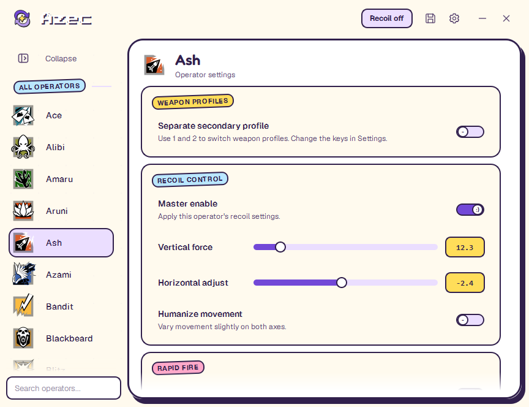
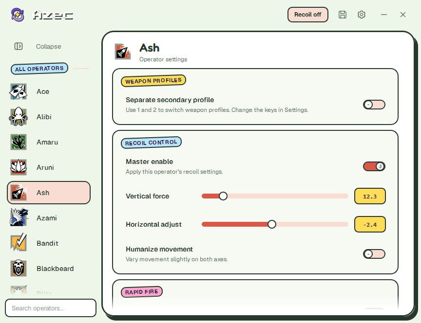
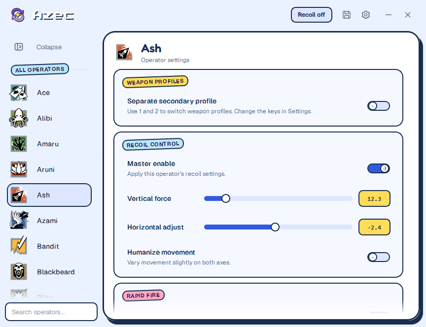
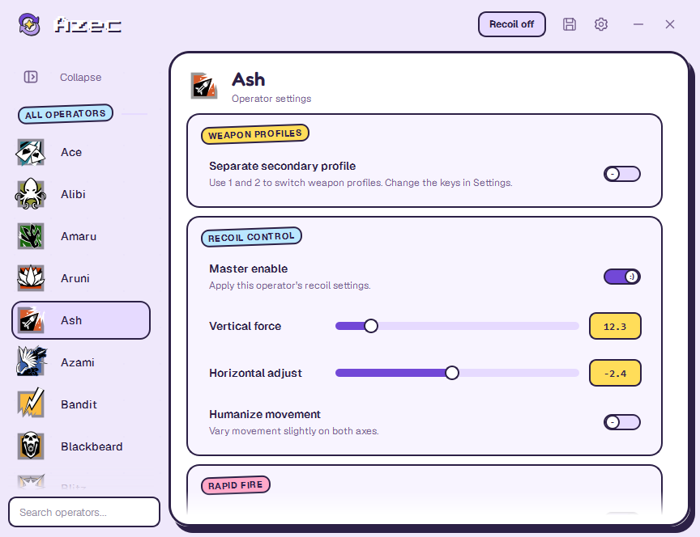
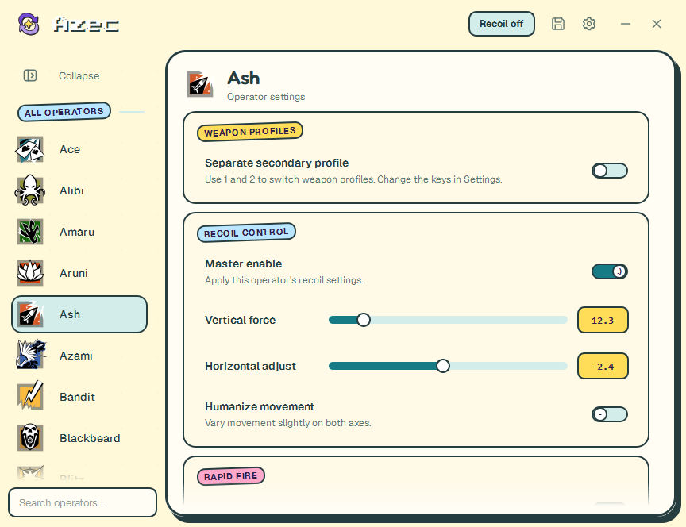
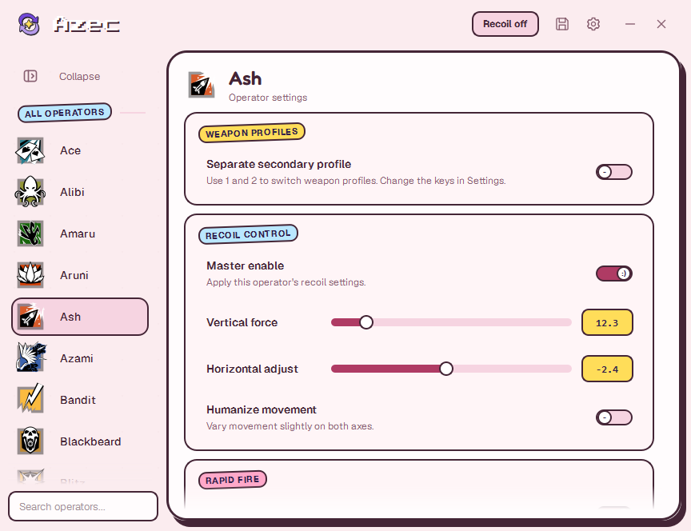
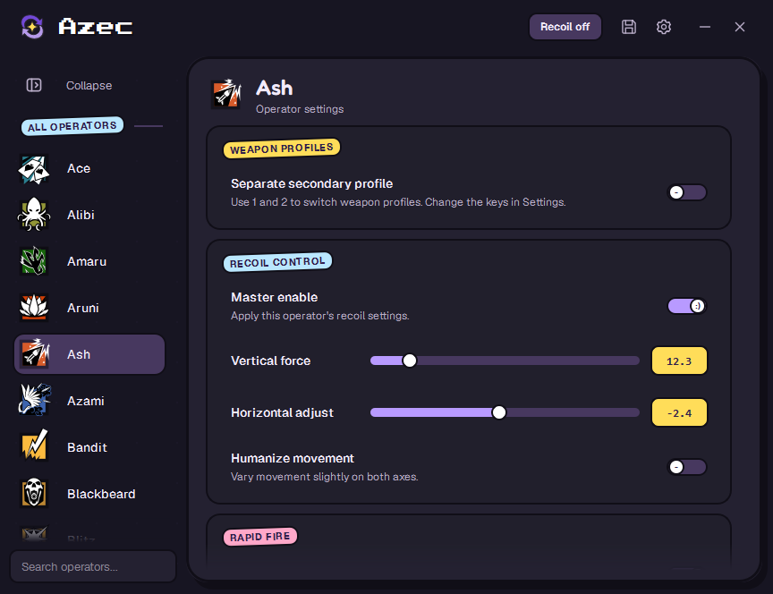
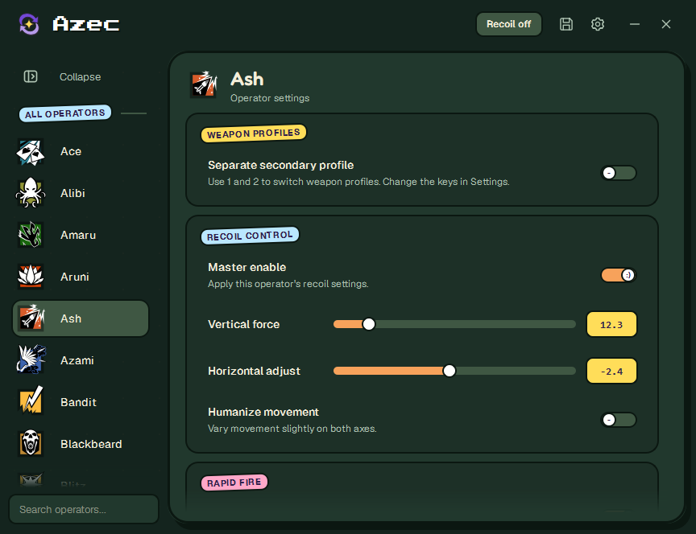
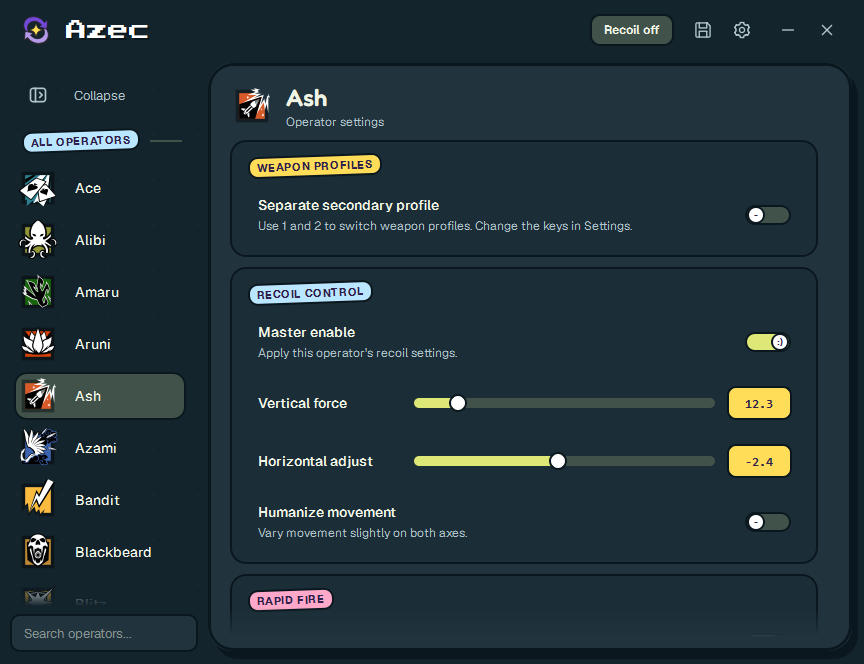
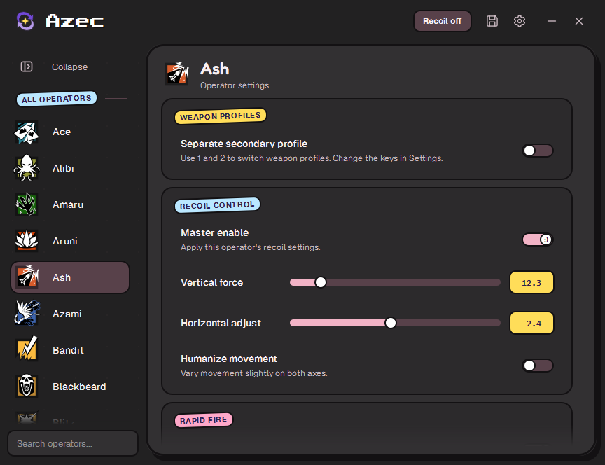

# Goofy color themes

Header 01, implemented in the Windows app: a seamless 60 px top bar matching the sidebar, with extra breathing room around the controls. All ten themes share the same layout. Switch in **Settings → Appearance → Color theme**.

These are native Qt screenshots at 100% display scale (864 × 664), captured from isolated dry-run fixtures.

## Goofy (original)

## Pistachio & coral

## Ice blue & cobalt

## Lilac

## Butter & ocean

## Rose

## Midnight violet

## Forest & tangerine

## Deep sea & citron

## Charcoal & blush

